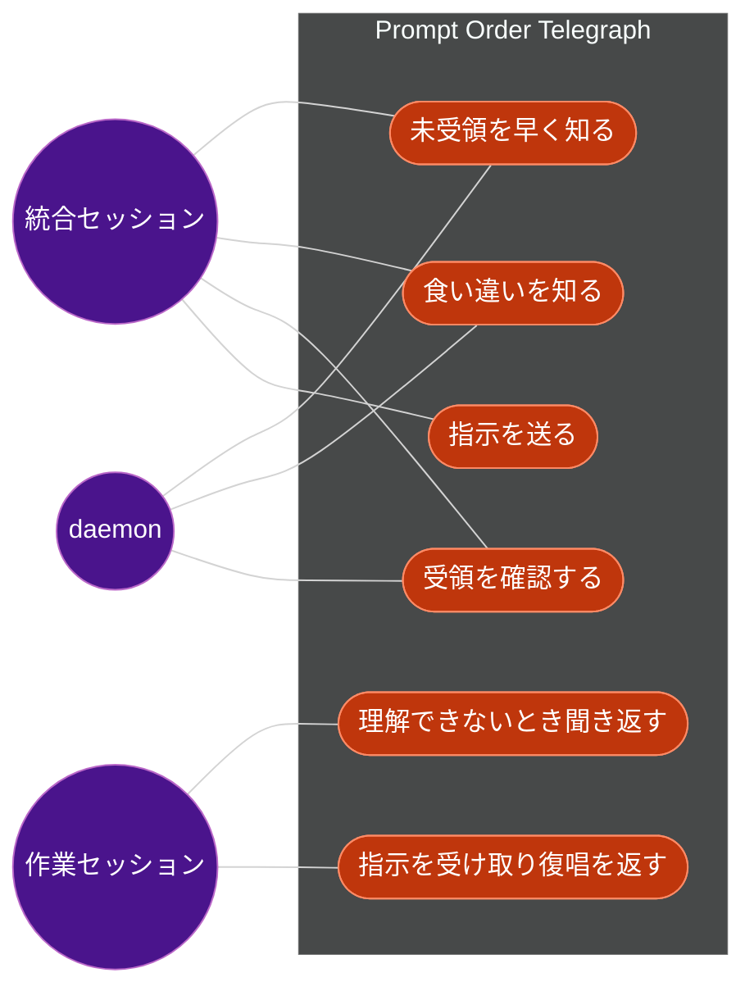

# Prompt Order Telegraph（指示の復唱） 要求仕様書

## 概要

親（統合セッション）が子へ送った要求（`node_send` の追加指示、差し戻しの理由、判断の回答、起動の指示）を、子が受け取って理解したかを、**作業の結果を待たずに**親が確認できるようにする要求を定義する。着想は、エンジンテレグラフ（船橋の指示を機関室が同じ内容で返して受領を知らせる仕組み）である（Issue #261。利用者の発案）。

本ドキュメントは [touryou.md](./touryou.md)（PRD）の FR_009（稼働中の子への追加指示）・FR_012（受信箱）を補う。touryou.md は書き換えない（PRD は人間の決定の記録であり、下流から自動では更新しない）。FR_009 に対する追加の要求として読む。

**対象範囲**

- 親から子へ向かう要求の受領の確認（復唱）と、食い違いの通知
- 復唱の中身の決め方と、秘密を残さない扱い

**対象外**: 実装（本チケットは AI-SDD のドキュメントだけを作る）

---

# 1. 背景

親が `node_send` や起動の指示で子へ要求を送っても、子が受け取って理解したかは、作業の結果が出るまで親には分からない。#255 の実例では、親の承認・指示 5 件が子に届かず 1 時間半以上止まり、「30 分たっても受け取っていない」の知らせ（FR_009 の未達の検知）が出るまで気づけなかった。

いまの仕組みで分かること・分からないことは次のとおり（実在を確かめた記述。確かめた場所は [prompt-order-telegraph_spec.md](../specification/prompt-order-telegraph_spec.md) の 1 章に書く）。

| 項目 | いま |
|:--|:--|
| 子が受信箱を読んだ事実 | 記録される（`node.instructionDelivered`。子の MCP が、受け取った最大の番号を付けて呼び直したときに印が付く） |
| 受け取った内容が、送った内容と同じか | 確かめていない（番号の印だけで、内容は照合しない） |
| 子が受け取らないとき | 既定 30 分（`cliWatch.unreadMinutes`）を超えると、指示ごとに 1 回、親の受信箱に知らせる |
| 子が指示を取り違えたとき | 作業の結果が出るまで分からない |

---

# 2. 要求一覧

## 2.1. ユースケース図

### ユースケース

| ID | ユースケース | 主アクター | 概要 |
|:--|:--|:--|:--|
| POT_UC1 | 指示を送る | 統合セッション | 追加指示・差し戻し・判断の回答・起動の指示を子へ送る（既存。FR_009） |
| POT_UC2 | 指示を受け取り復唱を返す | 作業セッション | 実行を始める前に、受け取った指示の復唱を返す |
| POT_UC3 | 受領を確認する | 統合セッション | 作業の結果を待たずに「子が受け取った」を確認する |
| POT_UC4 | 食い違いを知る | 統合セッション | 復唱が送った指示と合わないとき、親に分かる形で知らされる |
| POT_UC5 | 未受領を早く知る | 統合セッション | 復唱が一定時間内に返らないことを知る（既存の未達の知らせより早い基準を選べる） |
| POT_UC6 | 理解できないとき聞き返す | 作業セッション | 指示を理解できないときは、復唱の代わりに聞き返す |

---

# 3. 要求図（SysML Requirements Diagram）

```mermaid
%%{init: {'theme': 'dark'}}%%
requirementDiagram
    requirement KnowReceipt {
        id: UR_POT_001
        text: "親は、作業の結果を待たずに、子が指示を受け取ったことを確認できる"
        risk: medium
        verifymethod: demonstration
    }

    requirement CatchMixup {
        id: UR_POT_002
        text: "子が指示を取り違えたとき、親が早く気づける"
        risk: medium
        verifymethod: demonstration
    }

    requirement NoSecretLeak {
        id: UR_POT_003
        text: "復唱によって、コード・トークンなどの秘密が受信箱・記録に残らない"
        risk: high
        verifymethod: inspection
    }

    functionalRequirement Echo {
        id: FR_POT_001
        text: "子は、指示を受け取ったら実行を始める前に、指示の復唱を親へ返す。既定の復唱は指示のハッシュ値とする"
        risk: medium
        verifymethod: test
    }

    functionalRequirement ParentSees {
        id: FR_POT_002
        text: "親は、復唱が届いたことを、受信箱または状態の問い合わせで確認できる"
        risk: medium
        verifymethod: test
    }

    functionalRequirement Mismatch {
        id: FR_POT_003
        text: "復唱が送った指示と食い違うとき、システムは決定的に検出し、親に分かる形で知らせる"
        risk: medium
        verifymethod: test
    }

    functionalRequirement EarlyUnreceived {
        id: FR_POT_004
        text: "復唱が返らないままの指示を、既存の未達の知らせと矛盾せず親に知らせる"
        risk: medium
        verifymethod: test
    }

    functionalRequirement AskBack {
        id: FR_POT_005
        text: "子は、指示を理解できないとき、復唱の代わりに聞き返せる"
        risk: low
        verifymethod: demonstration
    }

    functionalRequirement BindLossSignal {
        id: FR_POT_006
        text: "復唱が返らないことを、紐付け切れの検出の材料にできるかを定める"
        risk: low
        verifymethod: analysis
    }

    designConstraint NoSecret {
        id: DC_POT_001
        text: "復唱に、コード・トークンを含めない。復唱の既定は全文ではなくハッシュ値"
        risk: high
        verifymethod: inspection
    }

    KnowReceipt - contains -> Echo
    KnowReceipt - contains -> ParentSees
    KnowReceipt - contains -> EarlyUnreceived
    CatchMixup - contains -> Mismatch
    CatchMixup - contains -> AskBack
    NoSecretLeak - derives -> NoSecret
    Echo - traces -> NoSecret
    EarlyUnreceived - traces -> BindLossSignal
```

---

# 4. 要求の詳細説明

## 4.0. ユーザー要求

| ID | 要求 | 優先度 | リスク |
|:--|:--|:--|:--|
| UR_POT_001 | 親は、作業の結果を待たずに、子が指示を受け取ったことを確認できる | Must | Medium |
| UR_POT_002 | 子が指示を取り違えたとき、親が早く気づける | Should | Medium |
| UR_POT_003 | 復唱によって、コード・トークンなどの秘密が受信箱・記録に残らない | Must | High |

## 4.1. 機能要求

### FR_POT_001: 指示の復唱

子は、指示を受け取ったら、実行を始める前に、指示の復唱を親へ返す。復唱の既定は**指示のハッシュ値**とする（利用者の決定。2026-11-24）。全文は既定にしない。ハッシュの作り方（アルゴリズム・桁数・正規化）は未決（[touryou-261-prompt-order-telegraph.md](../adr/touryou-261-prompt-order-telegraph.md)）。

- 派生元: UR_POT_001 ／ 優先度: Must ／ リスク: Medium
- **検証方法:** テスト

### FR_POT_002: 受領の確認

親は、復唱が届いたことを、作業の結果を待たずに確認できる。確認の経路（受信箱・状態の問い合わせ・状態画面のどれに出すか、どれが既定か）は未決。

- 派生元: UR_POT_001 ／ 優先度: Must ／ リスク: Medium
- **検証方法:** テスト

### FR_POT_003: 食い違いの検出と通知

復唱が、送った指示から決まる値と合わないとき、システムは、エージェントの判断を介さず決定的に検出し、親に分かる形で知らせる。食い違いの後の扱い（差し戻し・再送）は未決。

- 派生元: UR_POT_002 ／ 優先度: Should ／ リスク: Medium
- **検証方法:** テスト（食い違う復唱で通知が出ること、合う復唱では出ないこと）

### FR_POT_004: 復唱が返らないことの通知

復唱が一定時間返らない指示を、親に知らせる。既存の未達の知らせ（`cliWatch.unreadMinutes`。FR_009）と、**同じ指示に対して二重に出さない**。待ち時間の既定は未決。

- 派生元: UR_POT_001 ／ 優先度: Should ／ リスク: Medium
- **検証方法:** テスト（時刻を制御したテスト）

### FR_POT_005: 聞き返し

子は、指示を理解できないとき、復唱の代わりに親へ聞き返せる。聞き返しの経路（既存の判断要求〔FR_018〕との関係）は未決。

- 派生元: UR_POT_002 ／ 優先度: Could ／ リスク: Low
- **検証方法:** デモンストレーション

### FR_POT_006: 紐付け切れの検出への利用

復唱が返らないことを、紐付けが外れた CLI の子の検出（#255 の調査・設計）の材料にできるかを定める。材料にしない場合は、その理由を記録する。

- 派生元: UR_POT_001 ／ 優先度: Could ／ リスク: Low
- **検証方法:** 分析（設計での判断の記録）

## 4.2. 非機能要求

| ID | 要求 | カテゴリ | 優先度 | リスク | 検証方法 |
|:--|:--|:--|:--|:--|:--|
| NFR_POT_001 | 食い違いの検出は決定的であり、自動テストで網羅できる（touryou.md の NFR_007 と同じ） | 保守性 | Must | Low | インスペクション |
| NFR_POT_002 | 復唱の再送は重複しない（冪等。touryou.md の NFR_003 と同じ） | 信頼性 | Must | Medium | テスト |
| NFR_POT_003 | 復唱と食い違いは時系列の記録に残る（touryou.md の NFR_011 と同じ） | 監査性 | Must | Low | テスト |

## 4.3. 設計制約

### DC_POT_001: 復唱に秘密を含めない

復唱は、受信箱・記録・ログに残る。コード・トークンなどの秘密を、復唱に含めない。既定をハッシュ値にするのは、この制約による（全文は、秘密を含む指示では残してはならない）。秘密を含む指示そのものを送らない既存の規則（紐付けのコードは会話・報告に出さない）は変えない。

**検証方法:** インスペクション

---

# 5. 制約事項

- 追加指示は、子が idle のとき知らせで新しい番が始まり、実行中のときは番の終わりのあとに届く（touryou.md の FR_009）。復唱は、この届き方を変えない。
- 知らせは「ほかのセッションからのメッセージ」として届き、人間の承認としては扱われない（同）。復唱も、承認の代わりにならない。
- 子の AI は、ハッシュ値を確実には計算できない（言語モデルの計算は不確か）。復唱の計算は、AI の判断を介さない仕組み（MCP・フック）で行う前提を、設計で確かめる。

# 6. 前提条件

- 本 PRD は、touryou.md の木構造・受信箱・追加指示の仕組みが動いていることを前提とする。
- 実機で未確認の事項（手の空いた子が知らせで起きるか、など）は、#255 の調査 §6 に従い、統括が実機で確かめる。本 PRD では仮置きとして扱う。

# 7. スコープ外

- 実装（本チケットは AI-SDD のドキュメントの作成まで）
- 子から親への報告（`report_progress` など）の受領の確認（親から子への要求だけを対象とする）
- 人間から親への要求
- 指示の内容の意味の検証（復唱のハッシュ値は、同じ文字列を受け取ったことの確認であり、意味を理解したことの確認ではない）

# 8. 用語集

| 用語 | 定義 |
|:--|:--|
| 復唱 | 子が、受け取った指示を実行する前に、親へ返す確認。既定の中身は指示のハッシュ値 |
| 受領 | 子が指示を受け取ったこと。既存の「配送済み」（`node.instructionDelivered`）と同じ意味 |
| 食い違い | 復唱が、送った指示から決まる値と合わないこと |
| 聞き返し | 子が、指示を理解できないとき、復唱の代わりに親へ問い返すこと |
| エンジンテレグラフ | 船橋から機関室へ速度の指示を送り、機関室が同じ位置に合わせて返す装置。本機能の着想 |
