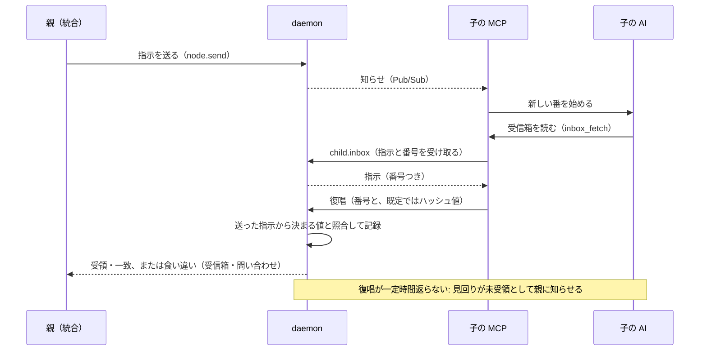

# Prompt Order Telegraph（指示の復唱）

**関連 Design Draft:** [design-draft.md](../task/261/design-draft.md)（一時ファイル。実装後に削除する）
**関連 Decision Log:** [touryou-261-prompt-order-telegraph.md](../adr/touryou-261-prompt-order-telegraph.md)
**関連 PRD:** [prompt-order-telegraph.md](../requirement/prompt-order-telegraph.md)
**親の仕様:** [touryou_spec.md](./touryou_spec.md)（5.3 制御・5.4 報告と受信箱）

---

# 1. 背景

親が子へ要求を送っても、子が受け取って理解したかは、作業の結果が出るまで分からない（#261、#255 の実例）。いまの仕組みの確かめた事実は次のとおり。実在を確かめた場所を添える。

| 事実 | 確かめた場所 |
|:--|:--|
| 子の受信箱の操作 `child.inbox`（mcp の道具は `inbox_fetch`）は、まだ受け取っていない追加の指示（`node.send`・差し戻しの理由・判断の回答。どれも `node.instructed`）を古い順に、番号（seq）を付けて返す | [touryou_design.md](./touryou_design.md) 138 行 |
| 「配送済み」は `node.instructionDelivered`（`deliveredSeq`）。mcp が応答を受け取ってから、受け取った最大の番号（`ackThrough`）を付けてもう一度呼び、daemon がそこで印を付ける | 同 194 行 |
| 子が受け取らないまま `cliWatch.unreadMinutes`（既定 30 分）を超えた指示は、指示ごとに 1 回、親の受信箱に知らせる | 同 179 行、`docs/config.md` の `cliWatch` |
| 子の道具は `report_progress`・`report_decision`・`decision_withdraw`・`report_outOfScope`・`report_done`・`scope_extend`・`inbox_fetch`（子の受信箱） | `plugin/skills/child/SKILL.md`、`CHANGELOG.md` の #168 PR3 の項 |
| 子から親への経路（`report_*`）は、親が受信箱で読む | 本仕様 [touryou_spec.md](./touryou_spec.md) 5.4 節 |

**`parent_report`・`parent_request` について（注意）**: この 2 つは、daemon が**親のセッション**に起動・停止・削除を依頼し（`parent_request`）、親が実行結果を報告する（`parent_report`）道具である。子から親への報告の道具ではない（`.sdd/adr/touryou-168-approval-route.md`、`docs/plugin.md` 80 行、`packages/daemon/src/api/handlers/parent-request-handlers.ts`）。Issue #261 の「経路（既存の `parent_report`・`parent_request` に種別を足すか）」は、この点を踏まえて読み替える（ADR の未決 2）。

# 2. 概要

- 子は、指示を受け取ったら、実行を始める前に、**復唱**を親へ返す。復唱の既定は指示のハッシュ値（利用者の決定）。
- 親（daemon）は、復唱が、送った指示から決まる値と合うかを決定的に照合する。合えば「受領・一致」、合わなければ「食い違い」として親に知らせる。
- 復唱が一定時間返らない指示は、既存の未達の知らせと矛盾しない形で親に知らせる。
- 復唱は、コード・トークンなどの秘密を含まない。全文を既定にしない。
- 子は、指示を理解できないとき、復唱の代わりに聞き返せる。
- ハッシュ値の復唱が確かめるのは「同じ文字列を受け取った」ことで、「意味を理解した」ことではない。意味の取り違えは、聞き返し・親による作業の確認で補う。

# 3. 要求定義

## 3.1. 機能要件

PRD の要求 ID（`FR_POT_001`〜`FR_POT_006`）を正とする。

| ID | 要件 | 優先度 | 根拠 |
|:--|:--|:--|:--|
| FR-POT-001 | 子は指示の復唱を、実行を始める前に親へ返す。既定の中身はハッシュ値 | 必須 | UR_POT_001 |
| FR-POT-002 | 親は、復唱が届いたことを作業の結果を待たずに確認できる | 必須 | UR_POT_001 |
| FR-POT-003 | 復唱と送った指示の食い違いを決定的に検出し、親に知らせる | 推奨 | UR_POT_002 |
| FR-POT-004 | 復唱が返らない指示を親に知らせる。既存の未達の知らせと二重にしない | 推奨 | UR_POT_001 |
| FR-POT-005 | 子は、理解できない指示に、復唱の代わりに聞き返せる | 任意 | UR_POT_002 |
| FR-POT-006 | 復唱が返らないことを、紐付け切れの検出の材料にできるかを定める | 任意 | UR_POT_001 |

## 3.2. 非機能要件

| ID | カテゴリ | 要件 | 目標値 |
|:--|:--|:--|:--|
| NFR-POT-001 | 保守性 | 食い違いの判定は I/O を持たない純粋関数で、自動テストで網羅できる | 全分岐をテスト |
| NFR-POT-002 | 信頼性 | 同じ指示の同じ復唱を再送しても、記録も知らせも重複しない | 重複 0 |
| NFR-POT-003 | 監査性 | 復唱・食い違い・未受領は時系列の記録に残る | すべて記録 |
| NFR-POT-004 | セキュリティ | 復唱・知らせ・ログに、秘密（コード・トークン）が現れない | 現れない |

# 4. API

抽象的な単位だけを定める（名前・引数・形は設計で定める。未決の項目は、ADR の未決を参照）。

| 提供先 | 操作 | 概要 | 要求 |
|:--|:--|:--|:--|
| 子 | 指示の復唱 | 受け取った指示（番号）の復唱（既定はハッシュ値）を親へ返す。実行の開始前に行う | FR-POT-001 |
| 子 | 聞き返し | 理解できない指示について、問い返す（復唱の代わり） | FR-POT-005 |
| 統合 | 受領の確認 | 指示ごとの「送った・受領・一致・食い違い・未受領」を読む | FR-POT-002, FR-POT-003, FR-POT-004 |
| システム | 照合 | 復唱を、送った指示から決まる値と照合し、結果を記録する | FR-POT-003 |
| システム | 未受領の検出 | 復唱が一定時間ないまま残る指示を、見回りで知らせる | FR-POT-004 |

子に公開する操作に、人間宛ての連絡は含めない（親の仕様 4.1 節。FR_011, NFR_004）。

## 4.1. 型定義（論理構造）

```typescript
// 指示ごとの受領の状態（論理構造。名前は設計で定める）
type InstructionAckState =
  | 'sent'        // 送った。まだ受け取られていない
  | 'delivered'   // 受け取られた（既存の node.instructionDelivered）。復唱はまだ
  | 'echoed'      // 復唱が届き、送った指示から決まる値と合う
  | 'mismatched'  // 復唱が届いたが、合わない
  | 'askedBack'   // 子が聞き返した（復唱の代わり）
  | 'overdue';    // 復唱が一定時間返らない

interface InstructionEcho {
  instructionSeq: number; // 既存の知らせの番号（seq）
  digest?: string;        // 既定の中身。ハッシュ値。全文・秘密は含めない
}
```

# 5. 用語集

[prompt-order-telegraph.md](../requirement/prompt-order-telegraph.md) の 8 章を参照。

# 6. 使用例

```
親: node_send で子 X に「src/a.ts の関数 f を直して」を送る（seq 12）
daemon: 指示を記録し、指示の本文から決まる値（ハッシュ）を持つ
子 X: 知らせで番が始まり、受信箱を読み、seq 12 の復唱を返す（実行の前）
daemon: 復唱が合うと確かめて「受領・一致」を記録
親: 受信箱の取得で、seq 12 が「受領・一致」と分かる（作業の結果を待たない）
```

# 7. 振る舞い図



# 8. 制約事項

- システムから子への知らせは、既存の Pub/Sub（NFR_014）に従う。復唱は子から daemon への一方向の呼び出しで、daemon は子を呼ばない。
- 復唱は、承認・許可の代わりにならない。人間の判断は、知らせにも復唱にも乗せない（親の仕様 2 章）。
- 復唱の計算は、AI の判断を介さない仕組みで行う前提を、設計で確かめる（言語モデルは、ハッシュ値を確実には計算できない）。
- 未決の事項（復唱の経路・待ち時間・不一致の扱い・聞き返しの経路・紐付け切れの検出への利用・ハッシュの作り方）は、[touryou-261-prompt-order-telegraph.md](../adr/touryou-261-prompt-order-telegraph.md) に選択肢と推奨を書いてある。決まるまで、本仕様の API は抽象のままとする。

# 9. 既存の仕様との関係

| 既存 | 関係 | 確かめた場所 |
|:--|:--|:--|
| FR_009（追加指示。読まれない指示は所定の時間で親に知らせる） | 復唱は、これを補う。受領を、時間切れを待たず積極的に確認する | [touryou.md](../requirement/touryou.md) FR_009 |
| FR_012（受信箱） | 受領・食い違いの知らせの置き場の候補 | 同 FR_012 |
| FR_018（判断要求）・`report_decision` | 聞き返しの経路の候補（理解できない指示を判断要求にする） | 同 FR_018、`plugin/skills/child/SKILL.md` |
| `parent_request`・`parent_report` | **別物**。親のセッションに起動・停止・削除を依頼する道具で、子の復唱の経路には使えない | `.sdd/adr/touryou-168-approval-route.md` |
| #189（紐付けのトークンの idle 失効の見える化） | 復唱を出すことは、トークンを「使った」と数える呼び出し。期限の時計に影響するため、設計で確かめる | `CHANGELOG.md` #189、`docs/plugin.md` 204 行 |
| #195（最後の動きの数え方 `lastActivityMs`） | 復唱を「動き」に数えるかは未決。数えると、止まっているかもの知らせが復唱で消える | `CHANGELOG.md` #195、`packages/core/src/activity.ts` |
| #209（紐付けが外れているかもしれない子の検出） | 復唱が返らないことを材料にできるか（FR-POT-006）。検出は読み取りだけで、紐付けの条件は変えない | `CHANGELOG.md` #209、`docs/config.md` の `unsubscribedMinutes` |
| #255（手の空いた CLI の子の紐付けの調査と設計案） | 紐付けが外れた子は復唱を返せない。復唱の欠如は #255 の検出（`bindLostSuspect` など）の補助になりうる | [investigation.md](../task/255/investigation.md) |

**未確認**: Issue #261 は「#209 の判断の経路」と書くが、リポジトリの #209 は紐付けが外れているかもしれない子の検出である。判断の経路は FR_018・`report_decision` で、#209 の番号と一致しない。Issue の番号の誤記か、別の Issue かは、確かめられていない（ADR の「未確認」に残す）。
