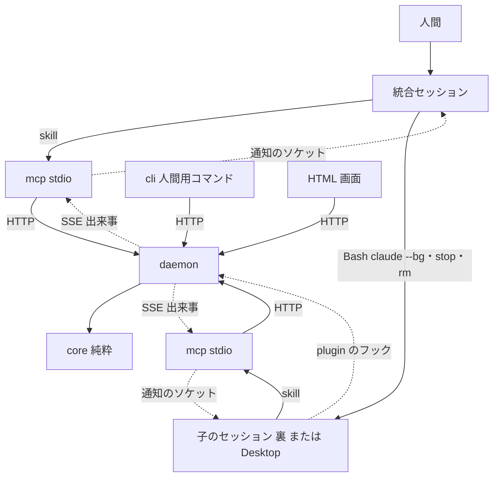

# TouRyou 技術設計

**関連 Spec:** [touryou_spec.md](touryou_spec.md)
**関連決定ログ:** [touryou.md](../adr/touryou.md)
**関連 PRD:** [touryou.md](../requirement/touryou.md)

> いまのコードに合わせた技術設計。決めたことの理由と却下した案は決定ログに置く。

---

# 1. 実装ステータス

**ステータス:** 🟢 実装済み

| モジュール | ステータス | 備考 |
|:--|:--|:--|
| `packages/core` | 🟢 | 木・状態遷移・回収判定・受信箱の整列・範囲の判定・窓口の契約の型 |
| `packages/daemon` | 🟢 | イベントログ・窓口（HTTP）・SSE・紐付け・フック受付・HTML 画面・自動の最終削除 |
| `packages/mcp` | 🟢 | セッションごとの stdio の MCP。ロール別の道具・購読・通知のソケット |
| `packages/cli` | 🟢 | 人間用コマンド・フックの入口・launchd |
| `plugin/` | 🟢 | skill・フック・MCP の設定・コマンド |

# 2. 設計目標

- 状態の窓口を `daemon` に集約し、状態の分裂を防ぐ（NFR_001）。
- 判定ロジック（回収可能、受信箱の整列、親子の不変条件、範囲の判定）を I/O のない純粋関数にする（A-001, NFR_007）。
- システムはセッションを起動・停止せず、Anthropic の認証を扱わない。起動・停止・削除は親のセッションに依頼し、結果を確かめる（FR_005・FR_010・FR_033・NFR_013）。環境ごとにできることは能力表で明示する（FR_034）。
- 呼び出しは「skill → mcp（stdio、セッションごとに 1 つ）→ daemon」の一方向。daemon からの知らせは Pub/Sub で、mcp が購読して自分のセッションに届ける（NFR_014）。
- 実行環境（CLI・Desktop）の違いをアダプタの背後に閉じる。

# 3. 技術スタック

| 領域 | 採用技術 | 選定理由 |
|:--|:--|:--|
| 言語・実行 | TypeScript（ESM、Node.js 22 以上） | 憲法の技術制約 |
| MCP | MCP TypeScript SDK、zod | Library-First。独自プロトコルを作らない（憲法） |
| 子の起動 | 使わない（親のセッションが Claude Code の `claude --bg`、または人間が Claude Desktop で開く） | システムが起動しなければ認証を扱わずに済む |
| 状態の保持 | SQLite（better-sqlite3。追記型のイベントログ） | 再起動後の復元（NFR_002）と時系列の記録（NFR_011）を 1 つの仕組みで満たす |
| テスト | Vitest、fast-check | 憲法の技術制約 |

# 4. アーキテクチャ

## 4.1. システム構成図



- 実線は呼び出しの向き、点線は知らせ（daemon は出来事を出すだけで、mcp もセッションも呼ばない。mcp が SSE を購読する）。
- 子の起動・停止・削除は、親のセッション（ここでは統合セッション）が Claude Code の機能で行う。

## 4.2. モジュール分割

| モジュール | 責務 | 依存 | 配置 |
|:--|:--|:--|:--|
| core | 木、状態遷移、回収判定、受信箱の整列、範囲の判定、不変条件、窓口の契約の型。時刻・識別子は引数で受ける | なし | `packages/core` |
| daemon | イベントログ、状態の唯一の窓口、出来事の配信（SSE）、紐付け、フック受付、HTML 画面、自動の最終削除。セッションを起動しない | core | `packages/daemon` |
| mcp | ロール別の道具の定義、入力検証（zod）、エラー設計。daemon の窓口を呼ぶ。出来事を購読し、自分のセッションの通知のソケットに書く | core | `packages/mcp` |
| cli | 人間用コマンド（purge、回収、回答など）、フックの入口、launchd | core | `packages/cli` |
| plugin | 役割定義の skill、フック設定、MCP 設定、コマンド | - | `plugin/` |

依存方向の制約により、`mcp`・`cli` は `daemon` に直接依存できない。`daemon` の窓口は、ローカル接続（127.0.0.1 の HTTP）で呼び出す。`mcp`・`cli` は、その接続の型を `core` が持つ契約（型）を通して扱う。

# 5. データモデル

状態はイベントの列から導出する。イベントは追記のみとする。

```typescript
interface OrchEvent {
  seq: number;          // daemon が採番する単調増加の番号
  at: string;           // ISO 8601。daemon が付与する
  requestId: string;    // 冪等性のための要求識別子
  actor: { nodeId: string } | { human: true } | { system: true };
  type: string;         // 'node.created' | 'node.stateChanged' | 'scope.violation' など（判別共用体）
  payload: unknown;     // type ごとに検証した値
}
```

- 同じ `requestId` で同じ内容のイベントは重複して追記しない。内容が違えば拒否する（NFR_003）。
- 現在の状態は、イベント列を `core` の純粋関数（`foldEvents`）で畳み込んで得る。daemon はスナップショットを持つが、写しではなくキャッシュとして扱い、合わなければ捨ててログから作り直す。

# 6. インターフェース定義

## 6.1. 実行環境の能力表と依頼

実行環境は `RuntimeAdapter`（`kind: "cli" | "desktop"`）の背後に閉じる。CLI のアダプタは、子を自分で起動せず、親のセッションへの依頼と結果の確かめを行う。Desktop のアダプタは、人間が開いた子を紐付けで結ぶ。

```typescript
type ParentRequestKind = 'launch' | 'stop' | 'remove';

interface Capabilities {
  send: 'ok' | 'delayed' | 'unreliable' | 'unsupported';
  stopGraceful: boolean;
  stopImmediate: boolean;
  stopDelegated?: boolean;   // 停止を親（CLI）・人間（Desktop）に代行してもらう
  hooks: 'ok' | 'unverified' | 'unsupported';
  sessionId: boolean;
}
```

- daemon は依頼を記録して、親の mcp へ出来事として出す。親の skill が依頼を読み、Bash で実行して、結果（子のセッションの参照など）を mcp で報告する。
- 停止したかどうかは、親の報告だけでは決めない。作業ツリーを使うプロセスがないこと（`lsof-probe.ts`）を確かめてから `stopped` にする。
- 不可能な操作は、理由と代替手段を含む失敗を返す（FR_034, NFR_010）。
- 木の一覧（`tree.list`）の `nodes` の各ノードに、止まった子の未回答の判断の数 `pendingDecisions: { undeliverable, stopped }` を付ける（表の `pendingDecision` 列と同じ数え方。`undeliverable` は閉じた判断、`stopped` は running・waiting・stopping でない子の open の判断）。`touryou tree --json`・`touryou tree <nodeId>` がこれを出す。
- 判断への回答（`decision.answer`）の結果に `delivery: "delivered" | "skipped"` を付ける。`delivered` は、判断を出した子に追加の指示として届けた、または回答を添えて再開したとき。`skipped` は、届ける手段がない（`canDeliver`）・子が動いていない・再開しなかったとき。届けるのに失敗したときは、今までどおり `resumePending` の失敗を返す。`delivered` のときは、届け方 `deliveredVia: "resumed" | "instructed"` も付ける。`touryou answer` がこれを出す。
- 互換: どちらも任意の欄として足す（既存の欄は変えない）。古い cli・mcp・画面は知らない欄を読まない（cli の結果の検査は既存の欄だけを見る。daemon の `RESULT_KEYS` が欄を応答に通す）。新しい cli は、欄がない（古い daemon）・知らない値なら、今までどおり子の状態から見込みを出す。
- 子の受信箱: 子のロールの操作 `child.inbox`（mcp の子の道具は `inbox_fetch`）。自分のノードの分だけを返す。最初にブリーフ（目的・受け入れ基準・作業範囲・依存。未読には数えず、いつも返す）、続けて、まだ受け取っていない追加の指示（`node.send`・差し戻しの理由・判断の回答。どれも `node.instructed`）を古い順に、知らせの番号（seq）を付けて返す。本文は引用の形（各行に `> `）。`all: true` で受け取ったものも含めて読み直せる（印は変えない）。session_id で引いた要求（トークンなし）からは呼べない。

## 6.2. CLI の子の起動（親のセッションによる）

- 起動の文: 親の Bash で `cd <作業ツリー> && claude --bg "<指示>" --name <名前> --model <モデル> --effort <深さ> --plugin-dir '<plugin の場所>' --permission-mode dontAsk --settings '{"crossSessionInbound":"accept","permissions":{"allow":[...],"deny":[...]}}'`。
  - モデルと深さは依頼に含める（指定しないと親と別の既定で起動しうる）。plan モードの子では指定と違うモデルになることがあるので、実際のモデルを子の記録から読んで残す。
  - `crossSessionInbound` は、許可を飛ばすモードの子でも知らせを止めないため、いつも付ける。
  - 作業ツリーは、信頼済みのリポジトリの `git worktree` として作る。
  - 子ごとにフォークも選べる: `claude --resume <親の id> --fork-session --bg --name <名前>`（親の id は `claude agents --json` で調べる）。
- 子の許可: ふつうのモードの子は、道具を使うたびに許可の確認で止まり、人が子の画面を開くまで進まない。そこで、子は**範囲だけを許し（`permissions.allow`）、ほかは `--permission-mode dontAsk` で確認を出さずに断る**。範囲の外が要るときは、子が `scope_extend` で範囲の拡張を頼む。
  - 一覧は daemon の純粋関数 `childAllowList(scope, toolNames)`（`sdk/child-permissions.ts`）が、ノードの範囲から作る。中身は 4 つだけ: (1) 子の TouRyou の道具を `mcp__node__<道具>` と `mcp__plugin_<plugin 名>_node__<道具>` の 2 つの形で。(2) `allowedCommands` を `Bash(<コマンド>:*)` に。(3) `writableLocations` を `Edit(./<相対>/**)` に（ファイルを書く道具の規則は `Edit(...)` にまとめて照合される。`Write(...)` は一致しないので入れない）。(4) 作業ツリーの中の読み取り `Read(./**)`・`Grep(./**)`・`Glob(./**)`。
  - 入れないもの: ほかの MCP の道具、WebFetch・WebSearch、範囲の外の Bash。次のものは一覧に入れず `invalidScope` で失敗にする（起動の文を返さない）: シェルの特殊文字（`*` `;` `&` `|` `` ` `` `$` `<` `>` `"` `'` `\` 括弧・改行）を含むコマンド、`cd` で始まるもの、1 語だけのもの（前方一致で任意の引数が通る）、任意のコードが動く形（1 語目が `sh`・`bash`・`env`・`node`・`python`・`npx`・`sudo` など、2 語目が `exec`・`-e`・`-c` など、`git config`・`git -c`、`find` の `-exec`・`-delete` など。`npm run` などはスクリプトの名前まで書いたものだけ）、作業ツリーの外を指す書き込みの場所。
  - deny: `forbiddenLocations` と `.git` を、`Edit`・`Read` の `./<f>` と `./<f>/**` の両方の形で `permissions.deny` に入れる（場所がファイルのときにも当たるように）。作業ツリーの外の禁止の場所は allow にも入らないので、dontAsk が断る。
  - Bash の前方一致の限界: `Bash(git status:*)` は続く任意の旗も通す。git の危ない旗は、フックの範囲の判定（git の大域のオプションの拒否）に任せる。
  - `--settings` は利用者・リポジトリの settings に足される（置き換えない）。利用者や作業ツリーの settings に広い allow があれば、子も受け継ぐ。plugin の有効化まで外れるおそれがあるため、`--setting-sources` では絞らない。
  - 守りは二重: 範囲の外は dontAsk が断り、さらにフック（6.4）も断る。子に plugin（フック）が付かなかったときも、一覧の外は断られる。`acceptEdits`・`bypassPermissions` には切り替えない（範囲の外まで通るため）。
- 子の plugin: `claude --bg` で起動する子は新しいセッションなので、親の `--plugin-dir` は引き継がれない。そこで、親の mcp が自分の `CLAUDE_PLUGIN_ROOT` を `parent_request` に添え（道具の引数には出さない）、daemon が起動の文にいつも `--plugin-dir '<その場所>'` を足す。marketplace から入れた同じ plugin と重なっても 1 つにまとまる。
  - daemon の確かめ（`sdk/plugin-dir.ts` の `checkPluginDir`）: 実パスにしてから、絶対パスであること、1 重の引用符で安全にくくれること、`.claude-plugin/plugin.json` の `name` が TouRyou の plugin の名前と一致することを確かめる。実パスが `repoRoot`・`worktreeRoot`・`stateDir`・`~/.touryou` の中なら付けない（作業ツリーに偽の plugin を作って子に読ませるのを防ぐ）。満たさなければ付けず、親の受信箱に理由を出す（依頼ごとに 1 回。値・パスは出さない）。
  - 付けられなかった子を見つける: 親の起動の報告から `cliWatch.unboundMinutes`（既定 3 分）が過ぎても紐付けのない CLI の子を、受信箱に failure で出す（子ごとに 1 回）。「紐付けた」は、紐付けのトークンか `node.sessionBound` の記録だけで決める。紐付けのトークンはメモリだけなので、daemon の起動より前に起動の報告があった子は対象にせず、「紐付けをやり直して」の知らせに任せる。
- 紐付け: 子の最初の番で、子の mcp が `child_bind` を引数なしで呼び、daemon が子ごとの資格情報を返す（Desktop と同じ `POST /v1/bind`）。資格情報は mcp のプロセスの中だけに持つ。
  - 紐付けのコードは、起動の文にも指示にも会話にも入れない。daemon が作業ツリーの git のディレクトリに `touryou-bind-code`（0600。一時ファイルから名前を替える。リンクでないことを確かめる）を置き、子の mcp がそれを読む（持ち主・0600・リンクでないことを確かめてから）。bind が通ったら消す。コードの正は daemon のメモリで、ファイルは写し。
  - 紐付けの前の子に統合の道具を出さない: daemon は子の作業ツリーの git のディレクトリに印 `touryou-child`（中身はノードの ID）を置く。mcp は、起動したときの作業ディレクトリに印があれば「紐付け待ち」で開き（根のトークンを読まず、`child_bind` と `whoami` だけを出す）、読めないときも紐付け待ちに倒す。
  - 印と作業ツリーの確かめ（FR_006）は「誤りの防止」で、モデルに対する境界ではない。守りの境界は一回限りのコード（130 ビット・10 分・ノードに結ぶ）。子が root-token を読むことは、フックの範囲の判定で拒む。
  - session_id は秘密ではなく自己申告なので、ほかの生きているノードに結ばれた session_id は拒む。session_id で引いた結果は信頼度の低い報告にだけ使う（`trust: "sessionIdOnly"`）。session_id で引いた結果を使うフックは、引いた作業ツリーとフックの本文の `cwd` が合うことを確かめる。
  - 紐付けの最初に、mcp が daemon と自分のセッションのソケットに ping を送り、届くことを確かめる。
- 依頼の流れ:
  - **依頼**: CLI の子の `start` は、コードのファイルを書き、`node.parentRequested`（種類・作業ツリー。コードは入れない）と受信箱の info を記録する。中身は op `parent.request`（`nodeId`・親の `model`・`effort`・任意の `forkSessionRef`）で、変数のない文 `command` として返す。値は単一引用符で引用する（変数を含むコマンドは、ふつうのモードで許可の確認が出るため）。
  - **知らせ**: 依頼は、その子の親のセッション（`node.parentSessionSet`）の購読にだけ、種類 `request` で流す。記録がなければ流さず、受信箱とフックで拾う。
  - **報告**: op `parent.report`（`requestRef`・`outcome`・`sessionRef`・`reason`・`agentState`）。依頼の受信箱の項目を解決済みにする。失敗は failure、止まっていそうな状態（`need_input` など）は info を受信箱に出す。
  - **紐付けのやり直し**: コードがメモリにない（daemon の再起動・期限切れ）ときの bind の失敗は、起動の依頼のある動いている子について、受信箱に failure「紐付けをやり直して」を出す（同じ子に 1 回）。`node.bindCode` はコードを応答に入れず、ファイルを書き直して、子に `child_bind` を呼ばせる文を返す。
- 停止:
  - 親が起動を報告していない子は、コードとファイルを片付けて stopped と記録する。
  - 穏当な停止: (1) 停止の要求の記録が子の購読に知らせとして流れ、猶予（既定 60 秒・要求ごとに上書き）の間、`lsof-probe` で作業ツリーのプロセスを 5 秒ごとに調べ、なくなれば待つのをやめる（それだけでは stopped にしない。番の間にプロセスを持たない子は、生きていても見えないことがあるため）。(2) 猶予を過ぎたか、プロセスがなくなったら `node.parentRequested`（stop）を記録して stopIncomplete にし、受信箱に代行の文面を出す。即時は (2) だけ。`lsof` が使えない環境では (2) から始める。
  - 確かめ: 親の `claude stop` の報告（done）のあと、`lsof-probe` で作業ツリーを使うプロセスがないときだけ、`node.stopDeclared`・`confirmStopped` を記録して stopped にする。残っている・確かめられないときは stopIncomplete のまま受信箱に出す（`node_stop` の再試行か、`node_confirmStopped` の宣言）。
  - 削除: 停止を確かめたら `node.parentRequested`（remove）を記録する。文は `claude rm <子のセッション>`。`--discard-unpushed` は、人間が破棄を決めたノード（`node.discardDecided`）のときだけ付ける。拒まれたら消さずに受信箱に failure を出し、あとで破棄が決まれば旗つきで依頼し直す。子のセッションの参照がなければ `noSessionRef` で、`claude agents --json` で調べる手順を返す。
  - 受理した子（Issue #3）: 受理（`node.review` の accept）の記録と同じトランザクションで、親が起動を報告した子（起動の依頼に done の報告がある子）に `node.parentRequested`（stop）を記録し、受信箱に依頼を出す（`sessionStopBodies`）。状態は verified のまま変えない（成果は受理済みで、止めるのはセッションだけ。状態遷移の表は変えない）。親の「止めた」のあと `lsof-probe` で作業ツリーのプロセスがないと確かめたら、受信箱に info を出し、続けて削除（remove）を依頼する。残っている・確かめられないときは受信箱に stopIncomplete の項目を出し、`node_stop` が verified の子への依頼の出し直しとして受ける（まだ報告のない依頼があれば `alreadyFinished`）。受理のときに、まだ報告のない依頼が開いていれば停止の依頼は出さず、あとで `node_stop` で出すよう受信箱に info を出す（`sessionStopDeferredBodies`）。Desktop・紐付けだけの子は依頼を出さない。
  - 起動時の整合: daemon の起動時に、破棄の判断のあと削除の依頼の前に落ちていた子には旗つきの削除を依頼し、猶予の調べの最中に落ちていた子には `claude stop` を依頼して停止未完了にする。
  - Desktop の子（daemon の外で動く子。`childRuntime: "desktop"`）は、起動時の整合でプロセスと照合せず、状態も変えない。記録で running・waiting・stopping・stopIncomplete の Desktop の子があれば、根の受信箱に、人に確かめてもらう依頼（stopIncomplete の帯）をまとめて 1 件出す（未解決の古い依頼は置き換える。FR_036。`docs/desktop-runtime.md` の「再起動のあと」）。
- 統合（Issue #4）: 統合ロールの `node.integrate`（直接の子・verified だけ）が、子のブランチ `touryou/<名前>` を上流（親のブランチ）へ fast-forward だけで進める（`GitPorts.integrate`）。親のブランチがどこかの作業ツリーでチェックアウトされていれば、その作業ツリーで未保存の変更（追跡しているファイル）がないことを確かめてから `git merge --ff-only`（フックなし）、どこにもなければ `git update-ref`（古い値の検査つき）。すでに統合済みなら何もしない（`alreadyIntegrated`）。fast-forward できなければ `notFastForward`、未保存の変更があるか未追跡のファイルが上書きされるなら `targetDirty` で、何も変えない。統合したら受信箱に info を残す。merge・rebase は既定ではしない（人間が決める）。
- 止まったことの検出（状態だけでは見ない。承認の画面で止まっても working のままのことがあるため）:
  1. フック: 子の plugin の `Notification` のフックが、入力待ち（`permission_prompt`・`idle_prompt` など）を daemon のフック受付へ報告する。
  2. 見張り: 設定 `cliWatch`（`stallMinutes` 既定 30 分・`unreadMinutes` 既定 30 分・`intervalSec` 既定 60 秒）。親が起動を報告した running の子で、最後の動きから `stallMinutes` を超えたら「止まっているかもしれない」を受信箱に出す（同じ最後の動きには 1 回）。子が受け取らないまま `unreadMinutes` を超えた指示も、指示ごとに 1 回出す（FR_009）。判断待ちの子は出さない。daemon の起動の時刻を「最後の動き」の下限にする。知らせはノードごとに 24 時間で 20 件まで。
  3. 親の確かめ: 親が `claude agents --json` の状態を読み、mcp で報告する。止まっている子は、人間に attach を頼む（受信箱）。
- daemon は Claude Code を呼ばない（記録の時刻だけで決める。NFR_014）。
- 親の Bash の許可の確認: ふつうのモードでは確認が出うるので、TouRyou が使うコマンド（`claude --bg`・`claude stop`・`claude rm`・`claude agents --json`）を許可の一覧に入れる案内を `/touryou:setup` に置く。skill が親に実行させるコマンドは、変数を使わず値を書き込んだ形にする。
- 案内に書く注意: agent view の入力欄に貼った文は、新しい裏のセッションとして起動される。組織の管理の設定がある環境では、モデルの切り替えで設定の読み込みの失敗が出ることがある。

## 6.3. 知らせ（Pub/Sub）

- daemon: SSE（`api/sse-hub.ts`）に、ノードごとの出来事（指示・依頼・判断の結果・停止の指示）を出す。出来事は記録から作り、取りこぼしは `seq` で取り直せる。
- mcp: 起動時に自分のノードの SSE を購読する。出来事が来たら、環境変数 `CLAUDE_CODE_MESSAGING_SOCKET` のソケットに、トークンの auth の行を付けてから、本文を 1 行書く（書く形は公式の文書のセッション間のメッセージ）。接続から 30 秒以内に書き終える。
- 本文は「受信箱を読んで、書かれた手順に従って（番号 N）」の 1 行にとどめ、中身は受信箱で読む。
- 知らせは番の区切りで届く。番の最中に書いた知らせは、その番が終わったあとに届く。そのため、急ぐ停止は親の `claude stop` で行い、子の番の終わりのフック（Stop）でも受信箱に未読がないかを確かめる。
- 書くのは mcp（セッションが起動した子プロセス）で、Claude の Bash でも daemon でもない（Bash を通すと許可の確認が出うる。daemon から書くと「ほかのプロセス」として受け取る側の設定しだいになり、NFR_014 にも反する）。
- 書く文の形は版で変わりうるので、`notify-socket.ts` の 1 か所に閉じる。ソケットがない環境（Desktop など）は、番の区切りのフックで受信箱を読む。
- 知らせは「ほかのセッションからのメッセージ」として注意書き付きで届き、承認として扱われない。人間の判断は知らせに乗せない。
- 配送済みの意味: `node.instructionDelivered`（`deliveredSeq`）は「子が `child.inbox` で受け取った」記録。mcp は応答を受け取ってから、受け取った最大の番号（`ackThrough`）を付けてもう一度呼び、daemon はそこで印を付ける（応答が途中で切れたら印は付かず、次に同じものを返す）。知らせは指示ごとに 1 回だけ流れ、未読のままでも出し直さない。
- 購読の資格情報: 紐付けた子は子ごとの資格情報で自分のノードだけを購読する。紐付けの前は購読しない。根のトークンで購読するのは根のモードのセッションだけ。同じノードの資格情報に替わったら続きの seq から、違うノードなら「今より後」から始める。
- ノードの購読の出来事（`GET /v1/events?node=`）:
  - `ready`（`{"from":N}`）: つないだ直後に 1 件。購読する側は、これを続きの起点にする。
  - `node`（`{"seq":N,"kind":…,"childId"?:…}`）: ノードごとの出来事。中身は受信箱で読む。
  - `retired`（`{"reason":"retired"}`）: ノードのトークンが役目の終わり（受理など）で失効したとき、購読を閉じる前に 1 件だけ送る。中身は理由の種類だけで、トークン・nodeId は載せない。退役の場（資格情報の失効の知らせ）から購読へ知らせて閉じるので、heartbeat の確かめを待たない。heartbeat の確かめで退役を見つけたときも、同じく送ってから閉じる。退役でない失効（期限切れ・停止など）は送らず、今までどおり閉じるだけ。
  - mcp は `retired` を受けたら張り直さず、401 を受けたときと同じ後始末（資格情報を空にする・記録 `subscribeRetired` を 1 回）をする。そのため、退役のあとの 401（`apiAuthFailed` の `retiredExpired`）は出ない。古い daemon（`retired` を送らない）とつないだときは、今までどおり張り直しの 401 で止まる。古い mcp は `retired` を知らない出来事として読み捨て、今までどおり張り直しの 401 で止まる。根の購読（期限を付けないので退役しない）は、受けても 401 と同じに待って張り直す。
- 書けなかったとき: その番号を捨てず、次の出来事か購読の張り直しのときに最大の番号で知らせ直す。記録は 1 回だけ残す。mcp の起動の前に置かれた指示と、知らせが書けなかった指示は、番の区切りのフックが受信箱の未読を確かめて拾う。
- 宛先（メインのセッションが複数あるとき）:
  - ブロードキャストしない。宛先を session_id で決め、送り手の ID も付ける。
  - 親が子を作るとき・`node.bindCode` を呼ぶとき、mcp が自分の `CLAUDE_CODE_SESSION_ID` を `parentSessionId` として付ける（道具の引数には出さない）。daemon はそれを `node.parentSessionSet` として記録し、親が別のセッションに移ったら上書きする。
  - 統合ノードの出来事に、直接の子の受信箱の項目（decision・violation・failure・stopIncomplete・done）を足す（`kind: "child"`、`childId` つき）。
  - 子に関わる出来事は、その子の親のセッションの購読にだけ流す。記録がなければ、最後に親の操作をしたセッションへ流す。子に関わらない出来事も、最後に親の操作をしたセッションへ流す。
  - 親の操作がまだ記録にない間は、統合ノードの購読が session_id ごとに数えて**ちょうど 1 本**ならそこに流す。2 本以上の間は流さず、最大の seq の 1 件だけを取り置き、1 本に戻ったら宛先を確かめ直してから配る。
  - 子のノードの出来事は、そのノードの購読の全部に流す。
  - 宛先は配る時点の記録と接続で決まる（中身は受信箱にあり、知らせは読ませるきっかけにすぎない）。
  - 合う購読がないとき（親のセッションが閉じた・session_id が変わった）は、ほかのセッションには流さず、受信箱に残してフックで拾う。
  - 知らせの文には送り手の子の ID を 3 つまで入れる（残りは件数だけ。ID は 64 文字で切る）。
  - 守り: 根の購読には根のトークンが要るので、session_id を名乗っても新しい権限は生まれない。根のトークンを持つ同じユーザーのセッションどうしは、もとから受信箱を読める。

## 6.4. フック

- フックは plugin の `hooks.json` で入れる。フックの入力（`session_id`、`cwd`、ツール名、引数）を daemon のフック受付へ渡し、許可・拒否を決める。紐付けの前のセッション（TouRyou の子でないもの）には何もしない。拒否は範囲違反としてイベントに記録する。受信箱の違反の要約は「範囲違反（フックが拒んだ・<理由>）: <対象>」とし、拒否されたことを明示する（`daemon/src/compose.ts`。統合の skill は、その言葉のまま人に伝える）。`node.spawn`・`scope.decide` の `scopeNotSubset` は、上限が設定の根の範囲（`rootScope`）のとき、`cause` に `config.json` の `rootScope` を、`nextActions` に daemon の起動し直しを出す（設定は起動時にだけ読む）。
- 拒否の判定は、`core` の純粋関数（作業範囲と操作を入力にして判定を返す）で行う。
- CLI の子のフックはトークンを持たないので、daemon は紐付けの記録（`sessionBindings.lookupNodeBySession`）で session_id からノードを引き、running・waiting のときだけ扱う。入力の cwd がそのノードの作業ツリーの中かも確かめる。知らない session_id には何もしない。この形の報告は木の状態を動かさず、記録の行為者に `trust: "sessionIdOnly"` を写す。
- 子のノードでは、daemon の state のディレクトリ（`stateDir`）と設定ファイルを読み取り・書き込みとも禁じる。作業ツリーの git のディレクトリと `<作業ツリー>/.git` は書き込み・削除を禁じる（Bash の rm・mv・ln・cp・tee・sed -i・dd の of=・リダイレクト、git worktree の書き換えも）。`<共通の git>/worktrees`（ほかのノードの git のディレクトリ）は読み取りも禁じ、自分の git のディレクトリだけを除く。
- 印のある作業ツリーでは、紐付けの前の PreToolUse を、紐付けの道具（`child_bind`・`whoami`）のほかは拒否する。紐付けの前の例外の道具（`child_bind`・`whoami`・`ToolSearch`・TouRyou の plugin の `Skill`）は、紐付けが外れたあとも通る（読み取りと紐付けの試みだけで害が小さい）。
- 入力待ちの知らせ（Notification）は、同じノードに直近 10 分に出していれば足さない。窓はトークンつきの報告と session_id で引いた報告で分ける。
- git の設定は、`-c`・`--config-env`・`git config` の書き込みで、`alias.*`・`include.path`・`includeIf.*` を拒む。
- 線引き: Bash の検査はコマンドの字面の解析で、`python -c` の中の文字列や変数で組み立てたパスは見ない。印と禁じる場所は誤りと事故を防ぐためのもので、モデルが意図して外そうとすることに対する境界ではない。バックグラウンド起動（`run_in_background`、`&`、`nohup`、`setsid` など）は既定で拒否する。
- Stop のフックの「未読」は、`deliveredSeq` がまだない、そのノードあての指示の数で数える。

## 6.5. 配布・導入

- plugin（marketplace の zip）は本体を同梱しない。本体（daemon・`touryou-mcp`・`touryou`。Node 同梱の tar.gz）は GitHub Release に置き、その sha256 を zip の中の `checksums.json` に入れる。zip は marketplace の sha256 で Claude Code が確かめる。
- `/touryou:setup` は、plugin の中の `scripts/install-runtime.sh` を 1 回の承認で走らせる。script は、版・名前・sha256 を plugin の中の `checksums.json`・`plugin.json` からだけ読み（引数・環境変数では変えない。受け付ける引数は `--restart-daemon` だけ）、取得（https だけ）→ sha256 の照合 → quarantine の確かめ → `tar -t` の検査 → 一時ディレクトリへの展開とシンボリックリンクの検査 → `$HOME/.touryou/v<版>` → 新しい版の `--help` → `current` の付け替え（rename で入れ替え）の順に進む。照合が通るまで展開も実行もしない。どこで失敗しても `current` は古いまま。同じ版が入って動けば何もしない。
- 常駐（launchd の plist がある）で版が変わるときは、同意（`--restart-daemon`。チャットの「はい」のあと）がなければ何も変えずに終了コード 3。同意があれば、古い版で `launchd init`（生成物が同じかの確かめ）と `stop` → 付け替え → 新しい版で `apply --yes`。stop のあとのどこで失敗しても（付け替え・新しい版の apply）、前の版に戻して起動し直してから、そのときの状態（current の版・daemon が動いているか・次にすること）を出して止まる（NFR_015）。呼び出しは `env -u BASH_ENV -u ENV bash` で、script の頭で取り込まれた関数を消し PATH を OS の既定にする。tar の中身は、通常のファイル・ディレクトリ・中を指すシンボリックリンクだけを通す。配布物を作る側（`scripts/dist-build.sh`）は、lib の外を指す・行き先のないシンボリックリンクを取り除き、Release に付ける前の smoke（`scripts/dist-smoke.sh`）で、同じ検査の関数（install-runtime.sh を source した `scripts/dist-check.sh`）を tar.gz に当てる（#56）。初めての常駐の登録（`init` と `apply --yes`）は、/setup が「はい」を取ってから行う。
- 設定（`config.json`）は、/setup が 1 つのコマンドで書く（ホームの下・git のリポジトリ・未作成を確かめ、600 で書く）。承認は、導入・設定・常駐の登録で約 3 回（前は約 12 回。Bash は、この 3 つだけで、確かめのための別のコマンド・node の道具は、/setup の中で走らせない）。
- SessionStart のフック（`scripts/runtime-version-notice.sh`）は、`current` の版と plugin の版が違えば知らせるだけ。取得・daemon の起動し直しはしない。本体がない・読めないときは何も出さず、セッションを止めない。
- 取得先は本番（`plugin.json` の `repository`）に固定し、試しのための差し替えの道（引数・環境変数）は作らない。tag の前の実機の確かめは、直前の Release の配布物を使う（plugin の写しに、その `checksums.json` を置く。手順は `docs/setup-verification.md`。Issue #48）。
- daemon の寿命（統合セッション・子のセッションと別の寿命で動き、版上げの起動し直しは同意のあとだけ、失敗したら前の版に戻す）は NFR_015。IR_002 はフックの記録と拒否で、寿命の要求ではない。

## 6.6. plugin の shell script の書き方

plugin が利用者の Mac で走らせる shell script（`plugin/scripts/*.sh`。`install-runtime.sh`・`runtime-version-notice.sh`・`touryou-mcp-shim.sh`）は、次の決まりで書く。

- macOS の `/bin/bash`（3.2）と POSIX sh（macOS の sh〔bash の POSIX モード〕・dash）で同じに動く書き方にする。bash 4 以降の機能（連想配列・`${var,,}`・`mapfile`・`|&`・`;&` など）は使わない。
- 変数の展開は、すべて `${名前}` の形で書く（位置・特別な変数の `$1`・`$?`・`$$`・`$#`・`$@` はそのままでよい）。理由: macOS の bash 3.2 は、変数名の文字を 1 バイトずつ libc の `isalnum` で見る。macOS の libc は UTF-8 のロケールで 0x80〜0xFF を英字として扱うので、`$ver）` の全角の文字の 1 バイト目が名前に混ざり（`ver\xEF`）、`set -u` では unbound variable で止まる（#47）。C・POSIX のロケールでは起きないので、ロケールなしの試験では見つからない。
- 文字として `$` を出すときは `\$` と書く。shell でない言語（perl など）の `$` を引用符の中に書く行は、行末に `# plugin-check: allow-dollar` を付ける。
- `pnpm validate:plugin`（`scripts/plugin-check.mjs`）が検査する。`plugin/` の中の `.sh` では `$名前` をすべて拒み（印の行は除く）、`$名前` のすぐあとに ASCII でない文字があるものは、印があっても拒む。リポジトリの `scripts/*.sh` には、後者だけを当てる。コメントの行も検査する。
- 試験（`scripts/install-runtime.test.mjs`）は、ロケールなし・`ja_JP.UTF-8`・`en_US.UTF-8` の組で script を走らせる。仕組みの裏づけは macOS の CI（`ci-macos.yml`）。

# 7. 非機能要件実現方針

| 要件 | 実現方針 |
|:--|:--|
| NFR_001 | 状態の窓口を daemon のみとし、mcp・cli・画面は窓口を呼ぶ |
| NFR_002 | イベントログから状態を復元する。子のセッションは Claude Code が持つので daemon の再起動で消えず、mcp が SSE を張り直して `seq` で取り直す |
| NFR_003 | 要求識別子の一意制約で重複を弾く。処理中の同じ要求は最初の結果を待って同じ応答を返す |
| NFR_004 | ロールごとに道具の集合を分け、子には生成・停止・人間宛て・最終削除を公開しない。公開一覧をテストで固定する |
| NFR_005 | 窓口は 127.0.0.1 のみに bind し、ノードごとのトークンをノードの停止時に失効させる。トークンをログ・初期メッセージ・画面に出さない |
| NFR_006 | 回収は `git worktree remove`（強制なし）と `git branch -d` のみを使う。強制は破棄の判断を経た停止ノードに限る |
| NFR_007 | 判定ロジックは `core` の純粋関数にし、時刻・識別子・プロセス一覧は引数で受ける。fast-check で網羅する |
| NFR_008 | 画面への反映は変更イベントの購読（SSE）で行う |
| NFR_009 | 道具の応答に簡潔版・詳細版を設け、一覧は分割取得にする |
| NFR_010 | 失敗の応答は原因と次の操作を持つ型（Result）にそろえる（憲法 T-001） |
| NFR_011 | すべての状態変更をイベントとして追記する。拒否した操作も範囲違反として残す |
| NFR_012 | 特定のリポジトリ構成を前提にしない。plugin の設定にリポジトリのパスを埋め込まず、起動時に渡す |
| NFR_013 | Anthropic の認証を扱わない。子は起動する Claude Code・Claude Desktop の利用者の認証で動く |
| NFR_014 | daemon はセッションを呼ばず、出来事を SSE に出すだけ |
| NFR_015 | daemon は launchd（または手）で、セッションと別に動かす。版上げは導入の script が、同意（`--restart-daemon`）のあとだけ止めて起動し直し、新しい版の起動に失敗したら `current` を前の版に戻して起動し直す（6.5 節） |

# 8. テスト戦略

| テストレベル | 対象 | 目標 |
|:--|:--|:--|
| ユニット | core の回収判定の全条件、受信箱の整列、状態遷移、範囲の判定 | 全条件を網羅 |
| 性質ベース（fast-check） | 親子の回収不変条件、整列の決定性、任意の木での集計 | 任意の木で不変条件を維持 |
| 結合 | PRD の各ユースケースの主要フロー（生成、報告、判断、完了判定、回収） | 各 1 件以上 |
| 冪等性 | 生成、判断要求、回収、回答登録の再試行 | 各 1 件以上 |
| 境界 | 空の木、最大の深さ、重複した要求 | 憲法の標準に従う |
| 手動の確かめ | CLI の子の起動・停止・フック、Desktop の紐付け | 手順は `docs/manual-verification-checklist.md` |

テストは先に書く（D-001）。

# 9. 設計判断

## 9.1. 決定事項

決定と理由は [touryou.md](../adr/touryou.md) に置く。

## 9.2. 未解決の課題

| 課題 | 影響度 | 対応方針 |
|:--|:--|:--|
| 停止後に残るプロセス（バックグラウンド起動、SIGTERM / SIGKILL）の挙動 | 高 | フックでバックグラウンド起動を既定で拒否する。残ったプロセスは stopIncomplete として受信箱に出し、人間が確かめる |
| 紐付けのない子を知らせるまでの時間（既定 3 分） | 低 | 仮の値。使われ方を見て見直す |
| 猶予時間の既定値 60 秒 | 低 | 仮の値。猶予内に止まった件数と、代行に落ちた件数の記録から見直す |
| プロセス確認の OS 差（`lsof` の有無、権限、速度） | 中 | `lsof` を使う。使えない環境では停止を代行から始める |
| 作業ツリー・プロセスの cwd の実パス化の OS 差 | 中 | `core` はシンボリックリンクを解決しない。daemon のアダプタが realpath にして渡す |
| 入れ子の作業ツリーの範囲判定とプロセス確認 | 中 | 親の作業ツリーの確認に子のプロセスが含まれうる。扱いを決める |
| 木あたりの同時実行数と費用の上限 | 中 | 未定 |
| スナップショットの保存間隔（既定 1000 件）とログの肥大化 | 低 | 使われ方を見て見直す |
| `OrchState.requests`・`reports`・`toolDenials`・`exits` の保持上限とスナップショットの肥大 | 低 | いまは上限なし。必要になった時点で、古い要求識別子の打ち切りと差分のスナップショットを設計する |
| 場所の比較の大文字小文字・Unicode 正規化 | 高 | `core` は大文字小文字を畳み込み、NFC 正規化して比較する（区別する FS では過剰拒否で安全側）。実パス解決は daemon のアダプタの責務 |
| コマンド判定の方針 | 中 | (1) `2>&1` など一部のリダイレクトも一律拒否している。許す範囲を決める。(2) 判定不能（`unparsable`）の細分化。(3) 再解釈・実行コマンドの固定リストの見直し。(4) スクリプト経由の書き込みは構造上判定できない（spec 5.5） |
| 書式制御文字（Cf）の拒否で ZWJ を使う絵文字が使えない | 低 | 安全側の既定。必要になれば個別の文字だけ許す |
| ノードのトークンの最大有効期間 | 低 | いまは失効か再発行まで有効。発行日時は保存しているので、運用が見えた時点で期限を設ける |
| 受信箱の整列の計算量 | 低 | いまは O(n³)。Kahn 法と優先度付きキューで O(n log n) にできる。件数が増えてから見直す |
| ソケットに書く文の形が版で変わる | 中 | 公式の文書にある形を使い、1 か所に閉じる。ping で確かめ、動かなければフックに落とす |
| 子の許可の一覧（dontAsk）の誤り | 中 | 一覧を誤ると子が何もできない。範囲の中の操作が一覧に入ることを試験で確かめる |
| `--effort` が子に効くか | 低 | 害はないので付けたまま。子の記録で確かめられたら直す |
| 見張りの時間の既定値 | 低 | 使われ方を見て見直す |
| plugin の script を 1 回の承認で走らせる守り | 中 | 人が見るのは個々のコマンドでなく「plugin の中の script を引数なしで」になる。script の中身は zip の sha256 と試験で守る。macOS の実機での quarantine・承認の回数は手動の確かめ |
| resume・fork・compact で `CLAUDE_CODE_SESSION_ID` が変わるか | 中 | 変わる場合は、合う購読がないときの扱いのとおり受信箱に落ちる |

# 10. 変更履歴

## v1.4

- plugin の shell script の書き方（6.6 節）を足した。bash 3.2 の UTF-8 ロケールで、`$名前` のすぐあとの全角の文字が名前に混ざるのを避けるため、`${名前}` にそろえ、plugin-check で検査する（Issue #47）。

## v1.3

- 配布・導入（6.5 節）に、取得先を本番に固定し、tag の前の実機の確かめは直前の Release の配布物で行う決まりを足した（Issue #48）。

## v1.2

- 配布・導入（6.5 節）と NFR_015 の実現方針を足した。本体の導入を plugin の中の 1 本の script にまとめ、SessionStart で版の食い違いを知らせる（Issue #12）。

## v1.1

- 受理した CLI の子のセッションの停止・削除の依頼と、`node.integrate`（fast-forward だけの統合）を足した（Issue #3・#4）。

## v1.0

- 一時ドラフトから、いまのコードに合う設計を移して初版とした。
