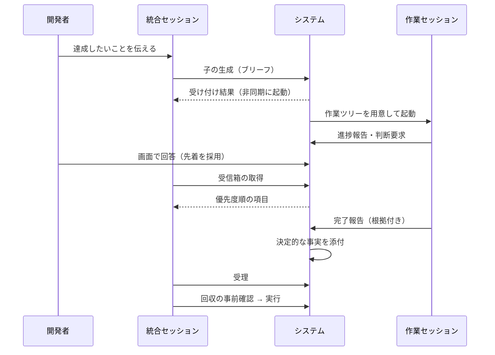

# TouRyou

**関連 Design:** [touryou_design.md](./touryou_design.md)
**関連 Decision Log:** [touryou.md](../adr/touryou.md)
**関連 PRD:** [touryou.md](../requirement/touryou.md)

---

# 1. 背景

複数の作業をエージェントへ並列に任せると、人間がセッションを行き来して状況を把握し、判断を配る負担が大きい。各作業セッションは本筋から外れやすく、統合セッションは自分の応答ターンでしか動けないため、監視・常時表示・判断の受付を統合セッションに任せる設計は成り立たない。

本仕様は、状態・監視・表示・判断の受付を統合セッションの外（常駐する仕組み）に置き、統合セッションには「子の情報をまとめ、順序付けて伝え、判断する」役割だけを与えるシステムの、抽象的な構造と振る舞いを定める。

# 2. 概要

- 複数の Claude セッションを、統合ノード 1 対 作業ノード n の木構造で管理する。人間は最上位の統合セッションとだけ対話する。
- システムが単一の状態を持ち、統合セッション・子セッション・HTML 画面・人間用コマンドはすべてその状態を通して参照・変更する。
- 子は、ブリーフ（目的・受け入れ基準・作業範囲・依存関係）だけを文脈として、専用の作業ツリーとブランチで作業する。
- 作業範囲外の操作は、エージェントの判断を介さず決定的に拒否され、記録される。
- 子の実行環境は Claude Code CLI（裏のセッション）と Claude Desktop の 2 種類があり、環境ごとの可能操作は明示される。
- システムはセッションを起動・停止しない。起動・停止・削除は親のセッションに依頼し、システムは親子の関係を管理して結果を確かめる（FR_005・FR_010・FR_033）。システムは Anthropic の認証を扱わない（NFR_013）。
- 呼び出しは「セッション（skill）→ MCP（セッションごとに 1 つ、stdio）→ daemon」の一方向。daemon からの知らせは Pub/Sub で、MCP が購読し、自分のセッションに届ける（NFR_014）。CLI では、MCP が自分のセッションの通知用のソケットに書くと新しい番が始まる（書く文の形は Claude Code の公式の文書〔セッション間のメッセージ〕にある。版の違いに備え、差し替えられる形にする）。知らせは「ほかのセッションからのメッセージ」として届くため、人間の判断は知らせに乗せない。
- Desktop 環境の前提のうち未確認のもの（PRD 6 章の項目 1〜7）は「手動確認待ち」であり、本仕様では仮置きとして扱う。確認後に仕様を更新する。

# 3. 要求定義

PRD の要求 ID を正とし、本仕様はそれを満たす振る舞いを定める。要求の本文は PRD を参照する。

## 3.1. 機能要件

| 区分 | PRD の要求 | 本仕様での扱い |
|:--|:--|:--|
| 木構造 | FR_001〜FR_004 | 5.1 節（ノードと木）。統合ノードは自ら作業しない |
| 生成と制御 | FR_005〜FR_010 | 5.2 節（生成）、5.3 節（制御）。環境差は 6 章 |
| 報告と受信箱 | FR_011〜FR_013 | 5.4 節 |
| 脱線 | FR_014〜FR_017 | 5.5 節 |
| 人間の判断と表示 | FR_018〜FR_021 | 5.6 節 |
| 完了判定と統合 | FR_022〜FR_025 | 5.7 節 |
| 回収と最終削除 | FR_026〜FR_031 | 5.8 節 |
| 実行環境 | FR_032〜FR_036 | 6 章 |

## 3.2. 非機能要件

PRD の NFR_001〜NFR_012 を満たす。本仕様で具体化した目標値は次のとおり。

| ID | カテゴリ | 要件 | 目標値 |
|:--|:--|:--|:--|
| NFR_008 | 性能 | 状態の変化が画面に反映されるまでの遅延 | 2 秒以内（仮の目標値。PRD に従う） |
| NFR_001 | 信頼性 | 状態の分裂がない | 同時に動く子の間で識別子が混ざらない |
| NFR_003 | 信頼性 | 再試行の冪等性 | 生成・判断要求・回収・回答登録を同じ要求識別子で再試行しても重複しない |

# 4. API

統合セッション・子セッションが使う操作（MCP ツール）、人間用コマンド、画面の操作を、抽象的な単位で定める。名前・引数の詳細は設計で定める。各ロールには役割に応じた操作だけを公開する（NFR_004）。

## 4.1. 操作の一覧

| 提供先 | 操作 | 概要 | 要求 |
|:--|:--|:--|:--|
| 統合 | 子の生成 | ブリーフから子を生成する。受け付け結果を即座に返し、起動は非同期 | FR_005, FR_008 |
| 統合 | 追加指示 | 稼働中の子へ指示を送る | FR_009 |
| 統合 | 子の停止 | 穏当な停止と即時停止を選ぶ | FR_010 |
| 統合 | 受信箱の取得 | 優先度・依存関係・時刻の順に整列して返す。前回以降の差分を取得できる | FR_012 |
| 統合 | 一覧表の取得 | 状態から決定的に生成した木の一覧表 | FR_020 |
| 統合 | 判断要求の提示 | 選択肢と自由入力欄を持つ判断要求を人間に提示する。回答は受信箱に届く | FR_018 |
| 統合 | 切り出し | 脱線部分を新しい子へ移し、元の子を本筋に戻すか停止する（一操作・原子的） | FR_016 |
| 統合 | 拡張要求の判定 | 子の拡張要求を承認・却下・切り出しのいずれかで判定する | FR_015 |
| 統合 | 完了の判定 | 受理または差し戻し | FR_024 |
| 統合 | 受理した子の統合 | fast-forward だけ。できなければ理由を返す | FR_024, FR_026 |
| 統合 | 回収の事前確認・実行 | 二段階。実行時に再判定する | FR_029 |
| 統合 | 可能操作の参照 | ノードごとに可能な操作を参照する | FR_034 |
| 統合 | 受信箱の項目の内容の取得 | 受信箱の項目の参照 ID（判断要求・報告）から、判断要求の内容と報告の本文（完了報告は根拠つき）を読む | FR_011, FR_012, FR_022 |
| 子 | 進捗報告・判断要求・スコープ外課題の申告 | 親へのみ報告する | FR_011 |
| 子 | 範囲の拡張要求 | 対象と理由を添える | FR_015 |
| 子 | 完了報告 | 受け入れ基準ごとの根拠を付ける | FR_022 |
| 子 | 紐付け（Desktop のみ） | 紐付けコードを、MCP とは別の紐付け専用の入口（`POST /v1/bind`）へ送り、ノードのトークンを受け取る。MCP の操作ではない | FR_032 |
| 人間（画面） | 判断への回答、回収の指示 | 回答は一本化を経由する | FR_019, FR_021 |
| 人間（コマンド） | 最終削除（purge） | エージェントには公開しない。墓標（タイトル、結果、最終コミット、日付）を残すかを選べる（省略時の既定は「残す」。保持ポリシーの設定で変えられる） | FR_031, DC_003 |
| 人間（コマンド） | 最終削除の事前確認 | 削除される木、木全体のアーカイブ日、経過日数を示す。何も変えない | FR_031, DC_003 |

子に公開する操作に、子の生成・停止、人間宛ての連絡、最終削除は含めない（FR_011, NFR_004, DC_003）。

統合ノードの操作のうち、ノード（またはそれを持つ判断要求・報告）を指すものは、呼び出した統合ノード自身の部分木に限る。規則は操作ごとに決める。追加指示、停止、切り出し、回収の事前確認・実行、可能操作の参照、判断要求の提示（一時停止するノード）は、自分自身を含まない子孫だけ（自分の停止は、親か人間だけができる）。完了の判定は、直接の子だけ（判定は親だけ）。子の生成（親ノード）と、判断要求・報告の取得（記録のノード）は、自分か子孫。受信箱・一覧は、自分の部分木に絞って返す。拡張要求の判定は、発生元の記録ができるまで統合ロールからは使えない。呼び出したノードは、クライアントの申告ではなく、daemon がノード専用の資格情報から決める。停止後・回収可能・アーカイブのノードの資格情報は無効とする。判定は core の純粋関数（`isInSubtree`・`isStrictDescendant`・`isDirectChild`・`visibleState`）で行う。

子が入れる文字列・配列には上限を設ける（報告の本文 64KB、判断要求の問い 8KB、選択肢 20 件・各 500 文字、根拠 50 件・各 4KB、理由・ツール名 1KB、受信箱の要約 200 文字。長さはコードポイントで数える）。タブ・改行以外の制御文字と書式制御文字（U+202E など）を含む値は拒否する。受信箱の項目の参照 ID（`ref`）は、記録済みで、項目の種類に合い、同じノードの判断要求・報告に限る。

## 4.2. 型定義（論理構造）

```typescript
type NodeRole = 'integrator' | 'implement' | 'review' | 'investigate' | 'merge';

type NodeState =
  | 'pending'      // 依存先の完了待ち
  | 'running'
  | 'waiting'      // 判断待ちで一時停止
  | 'done'         // 完了（未検証）
  | 'verified'     // 受理済み
  | 'stopping'     // 停止要求済み。停止の確認前（猶予時間内を含む）
  | 'stopIncomplete' // 停止要求後もプロセスが残存。停止したとは扱わない
  | 'stopped'
  | 'reclaimable'
  | 'archived';

type Runtime = 'cli' | 'desktop';

interface Brief {
  objective: string;
  acceptanceCriteria: string[];
  scope: Scope;
  dependsOn: string[]; // 先行ノードの ID
}

interface Scope {
  writableLocations: string[];
  forbiddenLocations: string[];
  allowedCommands: string[];
}

type InboxKind = 'decision' | 'answer' | 'violation' | 'failure' | 'stopIncomplete' | 'done' | 'progress' | 'info';
// 優先度: 要判断（decision, answer）＞ 失敗（violation, failure, stopIncomplete）＞ 完了 ＞ 進捗 ＞ 情報
// stopIncomplete: 停止要求後もプロセスが残っている。残っているプロセスと次の操作（再停止、人間の確認）の候補を添える

interface InboxItem {
  id: string;
  kind: InboxKind;
  nodeId: string;
  summary?: string; // 短い要約（200 文字以下）。全文は ref の参照先で読む
  ref?: string;     // 参照 ID（decision: decisionId、done・progress などの報告: reportId）
}
```

# 5. 振る舞い

## 5.1. ノードと木

- ノードは統合ノードまたは作業ノード（実装・レビュー・調査・マージ）である。統合ノードは統合ノードを子に持てる。
- 各ノードは、状態・要約・未処理の判断の問い合わせに応答する。
- 中間統合ノードには、配下の数が閾値を超えたとき、または独立した判断が必要なときにのみセッションを割り当てる。それ以外は、状態の集計とブロッカーの伝播を決定的に行う。
- 統合セッションは、実装・レビュー・調査・コンフリクト解消を自ら行わず、子を生成する。

## 5.2. 子の生成

- 子はブリーフだけを文脈として、親ノードのブランチから切った専用のブランチと作業ツリーで開始する。親の会話履歴は複製しない（会話の複製による分岐は、同じ文脈から別案を試す補助手段に限る）。
- システムは子ノード・ブリーフ・作業ツリー・一回限りの紐付けのコードを用意し、親のセッションに起動を依頼する（知らせ）。親が起動した子は、紐付けのコードで自分を子ノードに結び付ける。紐付けと作業ツリーの確認が済むまで、作業を許可しない。
- 依存先が指定された子は、依存先の完了まで起動を依頼しない。
- 兄弟ノードと書き込み範囲が重なる場合は、生成時に警告する。
- 生成要求は、同じ要求識別子で再試行しても子を重複して作らない。
- git 管理外の必要ファイル（ローカル設定など）は作業ツリーに引き継ぐ。
- 子が操作に使う接続は、子のセッションが読み込む MCP（stdio）で、ほかのプロセスが待ち受けを奪えるネットワークのポートを介さない。紐付けで得る子ごとの資格情報（システムの中だけのもの）は、相手が本物の窓口だと確かめてから送る（NFR_005）。Anthropic の認証は子に渡さない（NFR_013）。

## 5.3. 制御

- 追加指示: 作業範囲の拡大は追加指示では行わず、拡張要求（5.5 節）か切り出しで扱う。システムは指示を記録して子へ知らせ、子は受信箱から読む。追加指示は即時には処理されない場合があり、子が読んだことをシステムが確認する。未達は検知して受信箱へ通知する。
- 停止: 停止しても作業ツリーは既定で残す。停止後に作業ツリーを使うプロセスが残っていない確認ができるまで、停止したとは扱わない。
- システムは子のプロセスを止めない。穏当な停止は 2 段階で行う。(1) 子へ停止指示を知らせ、区切りのよい所で成果を保存して止まるよう依頼する。(2) 猶予時間内に止まらなければ、親のセッションに打ち切りを依頼する（CLI は `claude stop`）。猶予時間は設定値で、既定は 60 秒（仮の目標値。実行中のツールの長さを見て見直す）。
- 即時停止は猶予なしで (2) を依頼する。親が依頼を実行できないときは、受信箱で人間に知らせる。
- いずれも書き込み済みの成果は残し、子を再開可能な状態にする。
- 猶予時間は、停止要求ごとに上書きできる。猶予内に停止したか、猶予を超えて打ち切りに落ちたかを記録し、既定値を見直せるようにする。
- 停止要求後、作業ツリー配下にプロセスが残っている間、ノードは「停止要求済み」（`stopping`）にある。確認できないまま所定の時間を超えたときは「停止未完了」（`stopIncomplete`）とし、失敗として受信箱へ通知する。この状態のノードは、回収可能とは判定しない。所定の時間と再試行の方式は設計で定める。
- 判断待ちの間、指定した子を一時停止できる。

## 5.4. 報告と受信箱

- 子は親にのみ報告する。判断は必ず親を経由する。
- 受信箱は、子の報告、判断要求、範囲違反、回収可能化の通知、人間の回答を集約する。優先度（要判断 ＞ 失敗 ＞ 完了 ＞ 進捗 ＞ 情報）、依存関係、時刻の順に整列する。整列は決定的である。同じ優先度の中では、依存先のノードの項目を依存元のノードの項目より先に置き、依存のない項目どうしは時刻の昇順とする（同時刻は識別子の昇順）。
- 受信箱は、統合セッションから取得を要求されたときにのみ返す。各項目には次に取るべき操作の候補を添える。
- 中間統合ノードは、配下を要約して優先度を付けて上位の受信箱へ送る。システムが管理する中間統合ノードは、新しい項目が届いたときにシステムが起こしてよい。

## 5.5. 脱線の検知と切り出し

- 作業範囲（書き込みを許可する場所、禁止する場所、実行を許可するコマンド）の外にある操作は、フックにより決定的に拒否し、範囲違反として記録する。読み込みは制限しない。例外として、状態の置き場とシステムの設定ファイルは、読み込みも拒否する（FR_014 の例外。そのノード自身の HOME と、子に渡す skill の写しは除く。コマンドの判定は、書かれたパスに見える語だけを見る歯止めで、確実ではない）。
- 許可するコマンドの照合は、連結・パイプで分けた各部分の語の並びが、許可の語の並びで始まること（前方一致）とする。許可の項目も、命令と同じ規則で語に分ける（引用符を外す。区切りを含む項目は空白で分けるだけ）。承認した拡張は、子の次の操作の判定から効き、daemon の起動し直しでも失われない。子の許可の一覧（dontAsk）を越えて通すのは、承認したコマンドと語の数まで同じ命令（完全一致）と、承認した場所への書き込みだけとする。前方一致で通るだけの形は、子の実行環境の確かめに任せる。別のコマンドを再解釈・実行するもの（シェル、`eval`、`xargs`、`env`、`sudo` など）は許可の有無にかかわらず拒否する。許可したコマンドの中身（`pnpm test` が走らせるスクリプトなど）が行う書き込みは判定できないため、許可は最小にする。引数で書き込みや実行ができるコマンド（`git diff --output`、`sort -o`、インタプリタの `-e`/`-c` など）は、引数まで含めた許可項目にする。
- 範囲違反を受信箱で知らせるときは、操作がフックにより拒否された（実行されていない）ことを明示する。統合セッションは、人に伝えるときもその区別を保つ。
- 子の範囲は親の範囲の内側に限る。根の範囲は daemon の設定で与え、起動時に読む。根の範囲に収まらない子の生成の失敗は、直す場所（設定の根の範囲）と、変更を効かせるには daemon の起動し直しが要ることを示す。
- 初期範囲は狭くする。子は拡張要求を出し、親が承認（範囲を広げて続行）・却下・切り出しのいずれかで判定する。要求と判定結果は記録する。
- 切り出しは、新しい子の生成と、元の子の復帰または停止を、一回の操作で原子的に行う。途中で失敗した場合、片方だけが反映されない。

## 5.6. 人間の判断と表示

- 判断要求は、選択肢（各説明付き）と自由入力欄を持つ。要求は回答を待たずに受け付け結果を返す。
- 同じ判断要求に画面とチャットの両方から回答があった場合、先に確定した回答を採用し、後から来た回答は却下して採用された回答を伝える。
- 一覧表は状態から決定的に生成する。アーカイブ済みのノードは既定で表示しない。
- 一覧は、止まった子の未回答の判断（答えても届かないものと、子が止まっているもの）を、表とノードごとの構造の両方に出す。
- 判断への回答の結果は、回答を判断を出した子に届けたか、届ける手段がない・子が動いていないので届けなかったかを伝える（回答はどちらでも記録する）。
- HTML 画面は、統合セッションの応答ターンとは無関係に状態の変化を反映する。画面では判断への回答と回収の指示ができ、blocking な項目を目立たせる。明暗両方の配色に対応する。
- 画面の構成（#89）：
  - いちばん上に「いまあなたがすること」：人の操作が要るもの（判断待ち・範囲の拡張の頼み・止まっているかもしれない子〔daemon が入力待ちの見込みを知らせたときだけ。時刻の経過などから画面で推し量らない〕・停止の代行依頼）の数と一覧。それぞれに、その場の操作（答えのボタン、またはコマンドと写すボタン）を添える。なければ「いまはない」と示す。
  - 作業（子）ごとのまとまり：題（目的の先頭を短く切ったもの）・役割・状態・最後の動き（手元の時刻と経過）・人の要対応の数と、その子の受信箱の項目（新しい順。種類は利用者の言葉。長い文は開いて読める）。済んだ子・アーカイブした子のものはたたむ。
  - 「要対応」の数は、人の操作が要るものだけを数える（進み具合・済んだ・知らせを数えない）。
  - daemon が止まっているかもしれないと知らせた CLI の子には、子の画面を開くコマンドを示す。セッションの識別子は画面に出さない。
  - 関係図：親子の関係と、やり取りの上り（子 → 親）・下り（親・人 → 子）を示す。根を左に置く横向きの木で、1 本の枝に 2 本の道を並べ、上の道を上り（矢印は左向き）、下の道を下り（矢印は右向き）とする。やり取りは段（送った・まだ届いていない／届いた・返事を待っている／済んだ）を持ち、記録から導く。記録から導けない段は、導けないことを示す（推定したものは推定と示す）。図は見るだけで、木の一覧と切り替えられる。子の数に上限を設けない。
  - 動きはやり取りの段の変化に結びつけ、動きを減らす利用者の設定と画面の操作で止められる。止めても、色・印・文字で読める。
  - まれにしか使わない操作（最終削除・自動の最終削除の保留・破棄した成果の保管）は、たたんだ「管理」の欄に置く。取り消せないものは、それと分かるように示す。
  - あとで足す（#89 の外）：人が受信箱の項目を片付ける操作（#99。それまでは、済んだ子・アーカイブした子の項目をたたむだけ）。統合が子からのやり取りを受け取ったことの記録（#102。それまでは、子 → 親のやり取りの「届いた」は、分からないと示す）。
  - 画面の描画の安全（文字は文字として描く・外の資源を読まない・同じ配信元のものだけを実行する）は、図の部分にも同じく効かせる。
- 人間は、長く使える人間の資格情報を、コマンドの引数・URL・ブラウザの履歴・ログ・会話に出さずに、画面を開ける（#88）。人間用のコマンドが、資格情報を自分で読み、窓口の身元を確かめてから、使い捨てのチケット（短い期限・1 回だけ）をもらってブラウザに渡し、画面がそれを、期限つきで失効できる画面のセッションに交換する。画面のセッションは画面のメモリにだけ置き、人間と同じ操作ができ（取り消せない操作の確認はそのまま）、daemon の起動し直しで切れる。チケットの誤り・期限切れ・使用済みは、同じ形で断り、回数を制限する。ブラウザを開けない環境では、チケットを出さずに止まる。

## 5.7. 完了判定と統合

- 子は受け入れ基準ごとの根拠（テスト名、実行結果、コミットなど）を付けて完了を報告する。報告直後の状態は「完了（未検証）」とする。
- システムは、テストや静的検査の終了結果、変更が作業範囲内に収まっているかなどの決定的な事実を完了報告に添付する。
- 親は受理（検証済みへ進める）または差し戻し（未達項目と追加指示を付けて子を再開）を判定する。根拠だけで判定できないときは、レビュー役の子を生成する。
- 受理した直接の子の成果は、親が統合の操作で親ブランチへ統合できる。統合は fast-forward だけで行い、できない（親ブランチが先に進んでいる・親の作業ツリーに未保存の変更がある）ときは何も変えずに理由を返し、統合のしかたを人間の判断に委ねる。統合のあとは回収の条件 1 を満たす。
- fast-forward でない統合とコンフリクトの解消は、人間の判断のもとで、マージ役の作業ノードか人間が行う。
- 受理は状態を検証済みに進めるだけで、子のセッションは止めない。親が起動した子（CLI）は、受理のときに、親への依頼として子のセッションの停止と削除を出す（状態は検証済みのまま）。停止を確かめられなければ、統合ノードの停止の操作で依頼を出し直せる。

## 5.8. 回収と最終削除

次の条件をすべて満たすノードだけを回収可能と判定する（FR_026）。

1. 成果が親ブランチに統合済みである
2. 作業ツリーに未保存の変更がない
3. このノードに依存する未完了ノードがない（別サブツリーからの依存を含む）
4. このノードに紐づく未回答の判断がない
5. 統合ノードの場合、配下がすべて回収可能以降の状態にある
6. 作業ツリー配下で動作中のプロセスがない

- 停止したノードは条件 1 を満たさないため、破棄してよいという判断を経た場合に限り回収可能とする。破棄の判断は未保存の変更を捨てることを含むため、条件 2 も免除する。判断を求めるときは、未保存の変更の一覧を人間に提示する。
- 回収不可の場合は、満たしていない条件を短い理由で示し、統合ノードでは原因の配下ノードを名指しする。
- 親子の不変条件: 親が回収可能なら配下はすべて回収可能で、回収は配下へ連鎖する。配下に回収できないノードが一つでもあれば、親は回収できない。
- 回収は事前確認と実行の二段階で行い、実行時に再判定する。回収するのは作業ツリーと統合済みのブランチで、ノードの記録はアーカイブとして残す。失うものがある場合に拒否される安全な手段だけを用い、強制的な削除は破棄判断を経た停止ノードに限る。
- 自動回収の既定: 統合済みは回収可能になってから 24 時間後。停止したノードは自動回収せず、7 日後に破棄の確認を受信箱へ出す。作業ツリー数が上限（既定 10）を超えたら、猶予を短縮して古い順に回収する。手動回収のみも選べる。
- 最終削除は、最上位の木単位で、木全体のアーカイブから 90 日後に行う。墓標（タイトル、結果、最終コミット、日付）を残すかを選べる（既定は「残す」。監査と誤削除の追跡のため安全側。保持ポリシーの設定で変えられる）。保持ポリシーまたは人間用コマンドでのみ実行し、エージェントには公開しない。transcript は削除しない。

# 6. 実行環境

## 6.1. 可能操作の一覧

ノードごとに可能な操作を参照できる。不可能な操作が要求されたときは、理由と代替手段を示して失敗させる（FR_034）。

| 操作 | CLI | Desktop（手動確認待ち） |
|:--|:--|:--|
| 子の起動 | ○ 親のセッションが裏のセッションで起動（`claude --bg`。フォークも可。モデルと深さは依頼で指定）。システムは依頼と紐付けだけ | △ タスク生成機能（人間のチップ操作を介する）。戻り値は `task_id` のみ |
| 作業ツリーの指定 | ○ | △ 作業ツリー化は人間のチップ操作に依存。起動後にシステムが検証し、作業ツリーでなければ作業開始を許可しない（仮置き） |
| 追加指示（待機中） | ○ 知らせで新しい番が始まる | △ 保留・破棄され得る |
| 追加指示（実行中） | △ 番の最中には届かず、番の終わりのあとに届く。急ぐ停止は親の打ち切り | △ 同上 |
| 穏当な停止 | ○ 2 段階（指示 → 猶予後に親へ打ち切りを依頼） | ✕ 専用操作を確認できない。代行依頼（FR_036） |
| 即時停止 | ○ 親へ打ち切りを依頼（`claude stop`。削除は `claude rm`） | ✕ 同上 |
| 接続設定の注入 | ○ plugin の MCP（stdio）を子が読む。資格情報は紐付けで得る（裏のセッションも plugin を読む） | △ 初回メッセージ後に使える報告がある |
| フックの注入 | ○ plugin のフックで記録と拒否 | △ 継承が未確認。効かない場合は保証できない |
| 子の識別子の取得 | ○ 継承される識別子を除く | ✕ 戻り値にない |
| 覗き見 | △ 複製を読み取り専用で開く | ○ Desktop の画面（識別子の対応付けは未確認） |
| 完了の検知 | ○ | △ 自動検知は未確認。親が読みに行く |

## 6.2. Desktop の子の紐付け（FR_032）

1. システムが一回限りの紐付けコードを発行する。
2. 統合セッションが、Desktop のタスク生成機能でコードを含む指示を渡して子を起動する。
3. 子は、コードを紐付け専用の入口（`POST /v1/bind`。MCP とは別）へ送り、ノードのトークンを受け取る。コードは一回限りで、使用済み・期限切れは拒否する。
4. 子は、そのトークンで MCP に接続する（bind → トークン → MCP）。接続後、子には子に許可された操作だけが見える。

Desktop の子が紐付けの入口を呼ぶ手段（`curl` などを実行できるか）は、手動確認（項目 4）で確定する。

起動時の指示が「人間のメッセージ」として扱われない場合、手順 3 は初回メッセージの後に行う（仮置き）。紐付けまでの間と、作業ツリーであることの検証（FR_006）が済むまでの間は、子に作業を許可しない。

## 6.3. Desktop の子に対する操作代行（FR_036）

システムが直接操作できない停止などが必要になったとき、システムは受信箱を通じて親に代行を依頼し、親が Desktop の機能で実行した結果を報告する。代行までの間の安全は、作業範囲外の拒否（5.5 節）で担保する。フックが Desktop の子に効くことが前提であり、効かない場合は保証できない。

# 7. 用語集

用語は PRD の用語集に従う。

# 8. 使用例

統合セッションが 2 つの子に分けて依頼し、判断を受け、回収するまでの流れ。



# 9. 制約事項

- 統合セッションは自分の応答ターンでしか動けない。監視・表示・判断の受付はセッションの外に置く。
- 受信箱は取得時のみ返すため、最上位の統合セッションは人間が話しかけるまで新しい項目を処理しない。
- Desktop の子は、制御できる範囲が CLI より狭い（6.1 節）。Desktop の手動確認（PRD 6 章）の結果で、本仕様の Desktop に関する記述（△ と ✕）が変わる。
- 本体（常駐部と道具）は plugin と別に配り、導入は plugin の中の手順が、plugin に入った照合の値と一致したものだけを置く。版の食い違いは、セッションの始まりに知らせるだけで、自動では更新しない。常駐部を止めて起動し直すのは、利用者の同意のあとだけ（NFR_015）。常駐への登録は、設定が常駐部の起動と同じ検査を通ったときだけ行い、常駐部が異常終了しているときは、状態の確認で最後の失敗の理由を見せる（NFR_015）。
- 単一開発者のローカル環境に限る。同時実行数と費用の上限は、設計で定める。
