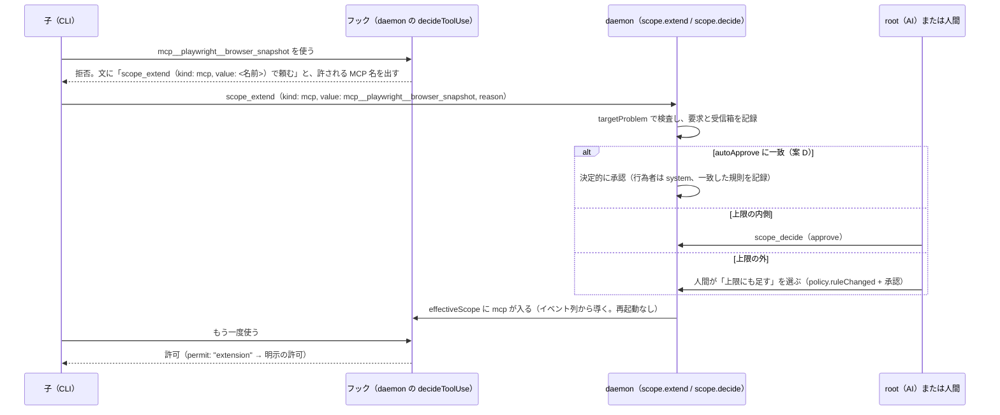

# 子の権限管理（Feature #194）設計書（案）

**関連 Issue:** #194（関連: #161・#186・#135・#91・#185・#189）
**関連決定ログ:** `.sdd/adr/touryou.md`（本体の更新は、親の承認の後に別の作業で行う。案は同じ場所の `adr-draft-*.md`）
**範囲:** 設計だけ。コードは書かない。

事実は、origin/main（`8d4bc25`）のコードを読んで確かめた。Issue の記述は主張として扱い、食い違いは § 1.2 に記す。

---

# 1. 現状の事実

## 1.1. コードの該当箇所

| # | 事実 | 場所 |
|:--|:--|:--|
| F1 | `allowedCommands` は、語の並びの前方一致。`entryWords` が命令と同じ字句解析で項目を語に分け、`wordsCover` が先頭の語から完全一致を見る。`grep -rn` を許すと `grep -rn foo` も通る | `packages/core/src/scope.ts:317-328`、`checkCommand` `:330-352` |
| F2 | コマンドの判定には、許可リストとは別の固定の拒否がある（`unparsable`・`backgroundExecution`・`indirectExecution`〔bash・env・xargs・sudo など〕・`find -exec` 系）。許可リストに入れても通らない | `scope.ts:266-352` |
| F3 | 範囲の「子 ⊆ 親」の検査は `isScopeSubset`。コマンドは「子の各項目を、親のどれかの項目が前方一致で含む」 | `scope.ts:389-412` |
| F4 | CLI の子は `claude --bg … --permission-mode dontAsk --settings '<JSON>'` で起動する。JSON の `permissions.allow・deny` は**起動のときの 1 回で固定**。中身は `childAllowList` が範囲から作る | `packages/daemon/src/sdk/launch-command.ts:4-27,55-77` |
| F5 | `childAllowList` は、`allowedCommands` を `Bash(<語>:*)` にする。**1 語だけ**（`grep`・`node` など）、`cd` 始まり、任意のコードが動く形（`RUNNERS`・`npm exec` など）は `invalidScope` で失敗にする。MCP は、自ノードの touryou の道具（2 つの名前の形）だけを allow に入れる | `packages/daemon/src/sdk/child-permissions.ts:60-179`（`commandEntryProblem` `:117`） |
| F6 | 子のフックの判定 `decideToolUse` は、自ノードの touryou の MCP（子のロールの道具）以外の `mcp__*` を `denyUnknown` で拒否する。許す道は設定にない。拒否の文は「画面を見ている人に頼む」系で、**頼み方も許される MCP 名も出さない** | `packages/daemon/src/sdk/hook-policy.ts:746-750,871-874` |
| F7 | `scope_extend`（daemon の操作 `scope.extend`）の対象は `kind: "write" \| "command"` の 2 種類。`targetProblem` が値を検査し、要求と受信箱の項目（`violation`）を 1 トランザクションで記録する | `packages/core/src/events.ts:571-574`、`packages/daemon/src/api/handlers/scope-handlers.ts:62-190` |
| F8 | 承認（`scope.decide`）の検査 `checkApprove` は、拡張後の範囲を `validateScope` と `isScopeSubset` で確かめる。親の範囲は `effectiveScope(親) ?? deps.rootScope`。**上限が `rootScope`（設定ファイル）のときは、「config.json を直し、daemon を起動し直してから、もう一度判定する」と案内する** | `scope-handlers.ts:89-155`（`:139-146`） |
| F9 | ノードの有効な範囲 `effectiveScope` は、**イベント列から毎回導く**（ブリーフ + 承認済みの拡張）。承認は、次のフックの呼び出しから効き、再起動で失われない。承認の反映（アダプタの `updateScope`）に再起動は要らない | `events.ts:2613-2631`、`scope-handlers.ts:256-302`、`compose.ts:1661` |
| F10 | 起動のときの許可の一覧（F4）にない承認済みの拡張は、フックが明示の許可（`permissionDecision: "allow"`）を返して通す（`permit: "extension"`）。deny の規則は、明示の許可の後も Claude Code の側で効く | `compose.ts:1712-1765`、`packages/cli/src/hook.ts:104-122`、`hook-policy.ts:877-913` |
| F11 | 作業ツリーの中を探す読み取りだけのコマンド（`ls`・`find`・`grep`・`git ls-files`・`git grep`。許す旗の表あり）は、範囲によらずフックが許す（#92）。`head`・`tail`・`wc`・`sort`・`uniq` は、`\|` の直後で、位置の引数なしの形だけ許す | `packages/daemon/src/sdk/read-only-search.ts:1-155`、`hook-policy.ts:848-856` |
| F12 | `config.json` は daemon の起動のときだけ読む。未知のキーは起動を拒否する（外した項目 `LEGACY_KEYS` だけ無視）。`rootScope` は必須で、`writableLocations`・`forbiddenLocations`・`allowedCommands` | `packages/daemon/src/config.ts:226-304,772-800`、`docs/config.md:6,59` |
| F13 | `autoApprove` に当たるコードは、ない（`git grep` で `packages`・`docs`・`plugin`・`.sdd` に 0 件） | — |
| F14 | 禁じる場所（stateDir・daemon の設定ファイル・見張りの設定など）は、読み取りも書き込みも子に許さない。権限の正本を、リポジトリの外に置く前提は、すでにある | `hook-policy.ts:61-127`（`ProtectedKind`） |
| F15 | `parent_request` は、**親（統合ノード）が、子の起動・停止・削除のコマンドを受け取る道具**。子が権限を頼む道具ではない | `packages/daemon/src/api/handlers/parent-request-handlers.ts`、`packages/mcp/src/tools.ts:46,72`、`contract.ts:780` |
| F16 | 子の touryou の道具の一覧は `CHILD_MCP_TOOL_NAMES`。名前の形は `mcp__node__<道具>` と `mcp__plugin_touryou_node__<道具>`。親の道具（`node_spawn` など）も同じサーバーにある | `contract.ts:769-800` |
| F17 | #161 の調査は、案 B（root ごとに daemon を分ける。daemon・stateDir・設定が別）を推奨している。その場合、**root ごとの権限 = daemon ごとの config** になる | `.sdd/task/161/investigation.md` § 4 |

## 1.2. Issue の記述との食い違い

| Issue の記述 | 実際 | 設計への影響 |
|:--|:--|:--|
| 「子が `parent_request` で MCP ツールも頼め」 | `parent_request` は親の道具（F15）。子が頼む道は `scope_extend`（F7） | 依頼の入口は **`scope_extend` の対象の種類（kind）に `mcp` を足す**。新しい道具は作らない |
| 「1 語の `grep` も許せる」 | core の `wordsCover` では通る（F1）が、`childAllowList` が 1 語を `invalidScope` にする（F5）。子の起動が失敗する | 1 語の許可は、この設計でも入れない。`Bash(grep:*)` 相当は、読み取り専用の表（F11）の拡張で扱う（§ 3.4） |
| 「`grep -rn` を `allowedCommands` に足して再起動」 | `grep -rn foo` の形は、すでに F11 で許可される（旗 `r`・`n` が表にある）。足りないのは、`tail <ファイル>` のような、表にない形・コマンド | 「読み取り専用の表」と「利用者が足す許可」の境目を、設計で明確にする（§ 3.4） |
| 「承認の反映に daemon の再起動を要しない」（要望 3） | コマンドの承認は、すでに再起動不要（F9）。再起動が要るのは、**上限 `rootScope` を広げるとき**（F8） | 本当に直す対象は「**上限の変更**」。承認の流れ全体の作り直しではない（§ 3.2） |

---

# 2. 設計目標

1. **権限の書き方を、Claude Code の `permissions`（allow / deny / ask）にそろえる。** 利用者が学ぶものを増やさない。
2. **上限（天井）の変更に、daemon の再起動を要しない。** 子の紐付けの出し直し（#185・#189）を避ける。
3. **MCP ツールを、コマンドと同じ流れで、頼み・承認・監査できる。**
4. **権限の正本は、daemon 側（リポジトリの外）。** 子が書き換えられるものを正本にしない。
5. **子の権限は、常に、人間が決めた上限の内側。** 自動承認があっても、上限は広がらない。
6. **既存の config・子・イベント列を壊さない**（追加だけで互換）。

---

# 3. 設計

## 3.1. データ構造

```ts
/** Claude Code の permissions と同じ書き方の規則 1 つ（文字列のまま保持し、読み込みのときに解析する）。 */
type PermissionRule = string; // 例: "Bash(grep -rn:*)"・"Edit(docs/**)"・"mcp__playwright__browser_snapshot"

/** 1 つの root の権限の方針（daemon の正本）。 */
interface RootPolicy {
  /** 子に付与できる範囲の上限。規則の形は Claude Code と同じ。 */
  readonly allow: readonly PermissionRule[];
  /** 常に拒否する規則。allow・ask より強い。 */
  readonly deny: readonly PermissionRule[];
  /** 承認を、人間だけに限る規則（root の AI は承認できない。自動承認もされない）。 */
  readonly ask: readonly PermissionRule[];
  /** 自動承認してよい規則（allow の部分集合。§ 3.5）。 */
  readonly autoApprove: readonly PermissionRule[];
}
```

- **core に、規則の解析と照合の純粋関数を新設する**（`packages/core/src/permissions.ts`）。daemon・hook・CLI・UI が同じ実装を使う（`scope.ts` の `wordsCover` と同じ層）。
  - `parseRule(rule): ParsedRule | RuleError`
  - `matchRule(parsed, op): boolean`（`op` は、コマンド・書き込み先・MCP ツールの名前）
  - `evaluate(policy, op): "deny" | "ask" | "allow" | "none"`（§ 3.3 の順序）
- 対応する書き方は、次の部分集合に限る（**解析できない項目は、無視せず、設定の誤りとして断る**。フェイルクローズ）:

| 書き方 | 意味 | 照合 |
|:--|:--|:--|
| `Bash(<語の並び>:*)` | コマンドの前方一致（従来の `allowedCommands` と同じ） | `wordsCover`（F1） |
| `Bash(<語の並び>)` | 完全一致 | 語の数まで同じ |
| `Edit(<相対パス>/**)` | 書き込みの場所（作業ツリーからの相対） | `isUnder`（`scope.ts:118`） |
| `mcp__<サーバー>__<道具>` | MCP ツール 1 つ | 名前の完全一致 |
| `mcp__<サーバー>` | そのサーバーの全ツール | **子の依頼では使えない**（人間の config だけ。§ 3.6） |

- Claude Code 側の書き方の細部（`Bash(a *)` の空白区切りのワイルドカード、`mcp__server__*` など）は、**実装の前に、Claude Code の文書で確かめる**（本設計では、確かめていない。§ 8 の確認点 E1）。`Bash(...:*)` 以外の書き方は、確かめるまで入れない。
- **範囲の既存の型（`Scope`）には、MCP を足す。** `readonly allowedMcpTools?: readonly string[]`（省略は空。追加だけの変更で、既存のイベントと互換）。`isScopeSubset`・`validateScope`・`effectiveScope` が、この項目も同じ規則で扱う。

## 3.2. 要望 2・5: 上限（天井）の持ち方と、再起動なしの変更

**課題:** 再起動が要る本当の理由は、上限 `rootScope` が config にあり、起動のときだけ読むため（F8・F12）。

**設計:** 上限は、2 つの層の和で決まる。

```
実効の上限 = config の方針（人間が書く・読み込み直せる） ∪ 実行中に足した規則（イベント列。人間だけが足す・取り消す）
```

| 層 | 置き場 | 書ける人 | 変更の仕方 | 取り消し |
|:--|:--|:--|:--|:--|
| 基準 | `config.json`（0600・リポジトリの外） | 人間（手で編集） | `touryou config reload`（§ 3.2.1） | ファイルを直して、読み込み直す |
| 実行中の追加 | イベント列（stateDir。0700） | 人間だけ（画面・CLI） | イベントの追記。次のフックの呼び出しから効く | 取り消しのイベント |

- **`deny` は、基準の層だけでなく、実行中の層にも足せる**（人間だけ）。`deny` は、どの層にあっても、常に最優先（§ 3.3）。
- **root の AI は、上限を広げられない。** 上限を広げるのは、権限の昇格にあたる。root の AI ができるのは、上限の**内側**での承認だけ（今と同じ。F8）。
- 実行中の層の変更は、新しいイベント `policy.ruleChanged`（`{ list: "allow"|"deny"|"ask"|"autoApprove", rule, op: "add"|"remove" }`。行為者は人間だけ）で記録する。`effectiveScope` と同じく、**状態に二重に持たず、イベント列から導く**。daemon の再起動でも失われない。監査は、イベントそのもの。
- **「リポジトリの中のファイル」は正本にしない**（要望 5）。作業ツリーの `.claude/settings*.json` は、子が書き換えられる（`writeDenied` は Desktop の子の見張りの設定だけを守る。F14）。daemon は、これを**読まない**。使う場合は、`touryou permissions suggest`（標準出力に推奨の JSON を出すだけ。ファイルに書かない）で、人間が自分で取り込む（§ 3.8）。

### 3.2.1. 読み込み直し（`config.reload`）

- 人間のロールの新しい操作 `config.reload` と、CLI の `touryou config reload`、画面の「設定を読み込み直す」。ファイルの監視（自動）はしない（編集の途中を読む・利用者の知らない間に権限が変わるのを避ける）。
- 読み込み直す対象は、`rootScope`・`permissions`・`autoApprove` の項目**だけ**。ほかの項目（port・stateDir・`childRuntime` など）が変わっていれば、「再起動が要る」項目の名前を返し、反映しない。
- **原子的に入れ替える**: 新しい設定を、起動のときと同じ検査（`parseConfig`）に通し、通ったときだけ入れ替える。失敗したら、**今の方針のまま**で、理由を返し、受信箱に知らせる。
- 入れ替えで、すでに子に付与した範囲（ブリーフ + 承認済みの拡張）が、新しい上限をはみ出す場合: **子の範囲は縮めない**（子の作業を、親の知らない間に止めない）。受信箱に「上限からはみ出した子」の知らせを出す。ただし、**deny は、はみ出しの有無によらず、次のフックから効く**（§ 3.3）。

## 3.3. 判定の順序と deny の優先（要望 1）

フックの 1 回の判定は、次の順序で、**最初に決まったところで終わる**。

| 順 | 段 | 内容 | 結果 |
|:--|:--|:--|:--|
| 0 | 固定の守り | 禁じる場所（F14）・`indirectExecution`・`backgroundExecution`・`unparsable`・`.git`・作業ツリーの外の `cd`。**権限の設定では、解除できない** | 拒否 |
| 1 | deny | 基準の `deny` ∪ 実行中の `deny` ∪（v0.2.0）人間の `settings.json` の `deny`（§ 3.7） | 拒否（理由に規則を出す） |
| 2 | ask | 規則に一致 | 範囲に入っていても、**承認済みの拡張**がなければ通さない。承認は人間だけ（自動承認・root の AI の承認は不可） |
| 3 | 範囲 | 子の有効な範囲（ブリーフ + 承認済みの拡張）に入る | 許可 |
| 4 | 読み取り専用の表 | F11（`ls`・`find`・`grep`・`git ls-files`・`git grep`） | 許可 |
| 5 | それ以外 | — | 拒否（`commandNotAllowed`・`unknownTool`）。拒否の文に、頼み方と許される名前を出す（§ 3.6） |

- **許可の根拠は、常に「子の有効な範囲」（段 3）**。`permissions.allow` は、子の許可ではなく、**付与できる上限**。
  - これは、現在の `rootScope` の意味（子の範囲の上限。`docs/config.md:57-59`）と同じ。意味を変えないので、利用者の理解を壊さない。
- deny が、allow・ask・自動承認・範囲より強いのは、Claude Code の `permissions` の優先順位（deny → ask → allow）と同じ。**deny は、Claude Code の側（子の `--settings` の deny）でも効かせる**（F10: 明示の許可の後も deny は効く）。起動のあとに足した deny は、フックだけが見張るので、**フックが落ちたときは、拒否に倒れる**（今のフックの「daemon に届かない → 拒否」と同じ）。
- 起動のときの許可の一覧（F4）は、**変えない**（ブリーフの範囲から作る）。承認・実行中の変更は、フックの明示の許可（F10）で通す。

## 3.4. 要望 1: コマンドの許可の扱い（`allowedCommands` との関係）

- `rootScope.allowedCommands`（従来）は、**読み込みのときに `Bash(<語>:*)` の `allow` に変換して扱う**。残す（互換）。廃止の予定は、本設計の範囲外。
- 1 語の許可（`grep`・`tail`）は、**これまでどおり入れない**（F5。前方一致で任意の引数が通る）。次の 2 つで補う。
  1. 読み取り専用の表（F11）に、`tail <ファイル>`・`head <ファイル>`・`wc <ファイル>`・`cat`（作業ツリーの中のパスに限る）を、**旗の表と、パスの実パスの確かめつき**で足す。これは「利用者の許可」ではなく、**コードの表**の拡張（FR_014「読み込みは制限しない」の範囲）。別の PR で、旗の表ごとレビューする。
  2. 利用者が足す許可は、**2 語以上の形**（`tail -n`・`grep -rn`）で書く。F5 の検査（`commandEntryProblem`）は、そのまま使う。
- `Bash(...)` の規則は、**上限（`allow`）にも、自動承認（`autoApprove`）にも**、同じ検査（F5）を通す。任意のコードが動く形は、どの層にも書けない。

## 3.5. 要望 4: 自動承認

> **利用者の判断が要る点（確認点 Q1）。** 判断が返るまでは、案 D（推奨）で書く。A・B・C に変わっても、差し替えられる形にする。

**方針（案 D）:** 自動承認は、**人間が config に書いた規則に一致したものを、daemon が決定的に承認する**。AI は介さない。規則に一致しない上限内の依頼は、これまでどおり、root の AI か人間が承認する。

| 項目 | 設計 |
|:--|:--|
| 規則の置き場 | `autoApprove`（§ 3.1）。基準の層は config、実行中の層は人間だけ |
| 入れてよいもの | **読み取りだけで副作用がないもの**に限る。daemon が検査する（下） |
| 入れられないもの | 書き込み（`Edit(...)`・`kind: write`）・外部への送信・`git push` / `git commit` / `git add` などの、リポジトリを変えるコマンド・ネットワークを使うコマンド（`curl`・`ssh` など）・`ask` に一致するもの・`deny` に一致するもの |
| 検査の仕方 | **Bash**: 規則の先頭の語が、**読み取り専用の表**（F11 と § 3.4 の拡張）にあるものだけ。表にないコマンドは、`autoApprove` に書けない（設定の誤り）。**MCP**: daemon は、ツールが読み取りだけかを確かめられない（MCP の注釈 `readOnlyHint` は、サーバーの自己申告で、信用しない）。**人間が、名前で 1 つずつ列挙したものだけ**。`mcp__<サーバー>` 全体は書けない |
| 上限との関係 | `autoApprove` の各規則は、`allow`（上限）の内側でなければならない。外なら設定の誤り |
| 承認の記録 | 既存の `scope.extensionDecided` に、行為者 `{ system: true }` と、**一致した規則**（`via: { autoApprove: "<規則>" }`）を足す。受信箱に、優先度の低い知らせ（`extensionAutoApproved`）を出す（解決済みのまま） |
| 取り消し | 新しい拡張の状態 `revoked` とイベント `scope.extensionRevoked`（人間と、対象の祖先が実行できる）。`effectiveScope` は、`revoked` を除く。次のフックから効く。アダプタの `updateScope` も呼ぶ |
| 歯止め | 子ごとの自動承認の件数の上限（既定 50）。超えたら、自動承認をやめ、人間に回す。受信箱に知らせる |
| 全件の監査 | 上のイベントが、全件の記録になる。画面に「自動承認の一覧」と、規則ごとの件数・取り消しの操作を出す（§ 3.9） |

**自動承認の安全性の根拠:** 子が書ける文（`reason`）は、**規則の照合に使わない**。照合は、命令の語だけ。子の文でプロンプト注入しても、自動承認の範囲は広がらない。AI が判断する承認（root）は、今までと同じ。

## 3.6. 要望 3: MCP ツールの依頼

**設計: `scope_extend` の `kind` に `"mcp"` を足す。** 新しい道具・新しい操作は作らない（認証のない入口を増やさない。#186 の方針と同じ）。

流れ:



- **対象の検査（`targetProblem` の `mcp`）:** 値は `mcp__<サーバー>__<道具>` の形（`^mcp__[A-Za-z0-9_-]+__[A-Za-z0-9_-]+$`）。**サーバー全体（`mcp__<サーバー>`）は、子の依頼では断る**。
- **自ノードの touryou のサーバー（`ownMcpToolOf` が名前を返すもの）は、依頼で断る。** 親の道具（`node_spawn` など。F16）を、拡張で子に付与できてしまうのを防ぐ。窓口の側にも、ロールごとの操作表（NFR_004）があるが、多重に守る。
- **フック（`decideToolUse`）:** 自ノードの道具の判定（F6）の後ろに、「ほかの `mcp__*` は、有効な範囲の `allowedMcpTools` に完全一致すれば許可（`permit: "extension"`）」を足す。それ以外は、これまでの `denyUnknown`。
- **拒否の文（#186）:** 頼み方（`scope_extend` の `kind: mcp`）と、**上限（`allow`）にある MCP の名前**（上限 20 件まで）を出す。名前だけで、パス・秘密は出さない。純粋関数の `decideToolUse` には、**ヒントの引数**（許される名前の一覧）を足して渡す。
- **許可の効き方:** 子の `--settings` の allow（F4）には、MCP は入らないので、CLI の子（dontAsk）は、フックが明示の許可を返さないと通らない。F10 の仕組み（`permit: "extension"`）を、MCP にも使う。**この挙動（MCP のツールに、フックの明示の許可が効くか）は、実機で確かめ済み**（確認点 E2。2026-11-23。効く。§ 8 に結果と条件）。
- **MCP ツールの引数は、権限で絞れない**（Claude Code の規則は、名前だけ）。承認は「そのツールを、どんな引数でも使ってよい」と同じ。承認の画面には、これを書く。ブラウザなど外部へ届くツールは、**自動承認に入れない**（読み取りの確かめができない）。
- **子の紐付け・Desktop の子:** Desktop の子（`childRuntime: desktop`）は、別のフックの経路（`/v1/hook` の Desktop 版）。MCP の依頼は、**まず CLI の子だけ**で入れる（Desktop は v0.2.0 以降。確認点 E3）。

## 3.7. 要望 6: 人間の `settings.json`（任意）

> **利用者の判断が要る点（確認点 Q2）。** 親に判断要求を出す（`report_decision`）が、親が待ち状態の間は、2 件目を出せない。回答の後に出す。

推奨案: **deny だけを、常時読む**（案 C）。v0.1.7 は読まず（案 A）、v0.2.0 で入れる。

- 読む場所は、**ユーザー階層（`~/.claude/settings.json`）と、管理者の設定だけ**。作業ツリーの `.claude/settings*.json` は、子が書き換えられるので、**読まない**。
- 読むのは `permissions.deny` だけ。解析した規則を、段 1（§ 3.3）の deny に足す。**allow は読まない**。子の権限は、人間自身の権限を超えない（人間が deny したものは、子も使えない）が、人間の広い allow に引きずられない。
- 読み込みの失敗（ファイルがない・JSON でない・権限が緩い）: ファイルがなければ何もしない。壊れていれば、**読み込みを失敗とし、受信箱に知らせて、deny を足さない**（人間の deny が効かないことを、人間に知らせる）。
- 読み込みの時機: `config.reload` と同じ入口、およびフックの判定ごとに、ファイルの更新時刻を見て、変わっていれば読み直す（フックの遅れを避けるため、更新時刻の確かめだけ）。

## 3.8. 推奨設定の出力（`touryou permissions suggest`）

- 標準出力に、Claude Code の `permissions` の形（`allow`・`deny`）の JSON を出すだけ。ファイルに書かない。人間が、自分の `settings.json`・daemon の config に、自分で取り込む。
- 中身は、今の方針と、受信箱の「頼まれたが上限の外だった」依頼の集計から作る。**リポジトリの中のファイルを、daemon が読み込むことはない。**

## 3.9. UI（状態画面）

状態画面の仕様（`.sdd/specification/touryou-ui.md`）に従う。UI レビュー係のレビューを受ける。案:

| 画面 | 内容 |
|:--|:--|
| 範囲の拡張の承認カード | 対象の種類（コマンド・書き込み先・**MCP ツール**）。**MCP は「引数を絞れない」警告つき**。選択肢: 「この子だけ承認」「上限にも足して承認」「却下」「自動承認にも足して承認」（最後の 2 つの足す操作は、人間だけ） |
| 設定の窓 | `permissions`・`autoApprove` の読み取りだけの表示（基準 + 実行中の追加。どの層か）。実行中の追加の「取り消す」。「設定を読み込み直す」 |
| 自動承認の一覧 | 一致した規則・子・時刻・件数。「取り消す」 |
| 受信箱 | `extensionAutoApproved`（低い優先度）・「上限からはみ出した子」・「設定の読み込みの失敗」 |

---

# 4. config の新旧スキーマと移行

## 4.1. スキーマ

```jsonc
{
  // 従来（v0.1.6 まで）。そのまま読める。
  "stateDir": "...", "repoRoot": "...", "worktreeRoot": "...", "rootCwd": "...",
  "rootScope": { "writableLocations": ["src"], "forbiddenLocations": [".git"], "allowedCommands": ["git status"] },

  // 新しい（v0.1.7 以降。すべて省略可）。
  "permissions": {
    "allow": ["Bash(tail -n:*)", "mcp__playwright__browser_snapshot"],
    "deny":  ["Bash(git push:*)", "mcp__playwright__browser_navigate"],
    "ask":   ["Bash(git commit:*)"]
  },
  "autoApprove": { "allow": ["Bash(tail -n:*)"] }
}
```

- **新しい項目は、追加だけ。** `rootScope` は、**引き続き必須**（`writableLocations`・`forbiddenLocations` を持つため）。`permissions` と `autoApprove` は、省略すると空。
- **正規化:** 読み込みのときに、`RootPolicy`（§ 3.1）へ畳む。`allow` = `rootScope.allowedCommands`（を `Bash(...:*)` にしたもの）∪ `rootScope.writableLocations`（を `Edit(.../**)` にしたもの）∪ `permissions.allow`。`deny` = `rootScope.forbiddenLocations`（を `Edit`・`Read` の deny にしたもの）∪ `permissions.deny`。
  - 同じ内容を両方に書いてもよい（重複は 1 つにする）。同じ規則が `allow` と `deny` にあれば、**deny が勝つ**。
  - 書き込み・コマンドの意味は、今の `rootScope` と変えない（F3 の `isScopeSubset` を、そのまま使う）。MCP の規則は、`allowedMcpTools` として、同じ検査（子 ⊆ 親）に加える。
- **root ごと（要望 2）:** #161 の案 B（daemon ごとに root。F17）なら、**config ごと = root ごと**で、上の形のままで足りる。案 A（1 つの daemon に複数の root）が採られたら、`roots: { "<rootNodeId>": { rootScope, permissions, autoApprove } }` を**追加で**入れる（既存の top-level は、`rootNodeId` の root の既定として読む）。いまは、方針の取得を `policyOf(rootNodeId)` の 1 つの関数に閉じ込め、呼ぶ側が「root は 1 つ」を前提にしない形にしておく（確認点 Q3）。
- **daemon 全体の deny（要望 2）:** 案 B の daemon は 1 root なので、`permissions.deny` がそのまま daemon 全体の deny。案 A では、top-level の `permissions.deny` を、全 root に効く deny、`roots.<id>.permissions.deny` を root の deny にする。

## 4.2. 新旧の版の組み合わせ

config は未知のキーを拒否する（F12）ので、版の組み合わせを、次のとおりにする。

| daemon \ config | 旧（`permissions` なし） | 新（`permissions` あり） |
|:--|:--|:--|
| **旧**（〜0.1.6） | 動く（今のとおり） | **起動を拒否**（未知のキー `permissions`）。権限の設定が黙って無視されるより、安全 |
| **新**（0.1.7〜） | 動く。意味は変わらない（`rootScope` だけ。方針は `rootScope` から作る） | 動く |

- 利用者に、**ダウングレードの手順**を `docs/config.md` に書く（`permissions`・`autoApprove` を消してから、旧の daemon を起動する）。
- **旧の daemon の拒否の文は、変えられない**（すでに配布済み）。新の daemon が、新しい項目の説明（どの版から使えるか）を、`docs/config.md` と、`parseConfig` の「未知のキー」の文（将来の項目の名前の表を持ち、「この項目は新しい版の設定。daemon の版を上げて」と出す）に入れる。
- **イベント列・スナップショット:** `ExtensionTarget.kind` に `mcp`、`ExtensionRecord.status` に `revoked`、`policy.ruleChanged` を足すと、**旧の daemon は、新しい daemon が書いたイベント列を読めない**（未知のイベントの種類・値）。スナップショットの版（`eventlog.ts:83`）を上げ、**ダウングレードは、新しい種類のイベントを書く前までしかできない**と、`docs/` に書く（新しい種類を書かなければ、旧の daemon でも読める。追加の機能を使い始めるまで、戻せる）。
- **`touryou config migrate`（任意）:** 旧の `rootScope` から、同じ意味の `permissions` を標準出力に出す（ファイルには書かない）。移行を強制しない。

---

# 5. 段階的な実装計画

PR は、**前の PR だけで出荷してよい**（機能を増やしても、前の挙動を壊さない）順に分ける。

| PR | 内容 | 範囲 | 先行 |
|:--|:--|:--|:--|
| 1 | core に `permissions.ts`（規則の解析・照合・`evaluate`）と、`Scope.allowedMcpTools`（省略可）。**挙動の変更なし**。試験 | core | — |
| 2 | config の `permissions`・`autoApprove`（読み込み・検査・`RootPolicy` への正規化）、「未知のキー」の文、`docs/config.md`。**判定への接続はまだしない**（deny だけは接続してよい） | daemon・docs | 1 |
| 3 | **MCP の依頼**: `ExtensionTarget` に `mcp`、`targetProblem`、`checkApprove`（上限は `allow` から）、`effectiveScope`、フックの許可と拒否の文（#186）、`cli/hook.ts` の明示の許可、スナップショットの版。**最初に、実機で E2 を確かめる** | core・daemon・cli | 1・2 |
| 4 | **上限の変更に再起動を要しない**: `config.reload`（操作・CLI）、`policy.ruleChanged`（人間だけ）、「上限にも足して承認」、画面の承認カードと設定の窓（読み取り）。`docs/` | core・daemon・cli・UI | 2・3 |
| 5 | **自動承認**（案 D）: `autoApprove` の検査と照合、`scope.extensionDecided` の `via`、`scope.extensionRevoked`、件数の歯止め、画面の一覧と取り消し、読み取り専用の表の拡張（`tail`・`head`・`wc`・`cat`。別の PR に分けてもよい） | core・daemon・UI | 4 |
| 6 | 人間の `settings.json` の `deny`（案 C）、`touryou permissions suggest`、`config migrate`、（#161 が案 A なら）`roots`、Desktop の子の MCP | daemon・cli | 5 |

**v0.1.7 に入れる（提案）:** PR 1〜4。再起動の問題（上限の変更）と MCP の依頼という、Issue の 2 つの痛みを解く。追加だけで、既存の利用者に影響がない。
**v0.2.0 以降に回す（提案）:** PR 5・6。自動承認は、守りの考え（確認点 Q1）の確定と、実機での攻撃の試験・UX レビューが要り、権限を緩める方向の機能なので、PR 1〜4 の運用で上限の変更の流れが固まってから入れる。人間の `settings.json` は、案 A で出荷し、案 C は v0.2.0（確認点 Q2）。
**Q1 が A（自動承認なし）に決まれば、PR 5 は不要**（PR 5 の読み取り専用の表の拡張だけ、独立して入れる）。

---

# 6. 試験の計画

| レベル | 対象 | 主な内容 |
|:--|:--|:--|
| 単体（core） | `permissions.ts` | 規則の解析（正常・不正・`Bash(a b:*)`・`mcp__a__b`・解析できない書き方の拒否）、照合（語の前方一致・語の境界〔`cd` と `cdx`〕・完全一致）、`evaluate` の順序（deny > ask > allow。同じ規則が allow と deny にある）、`isScopeSubset` の `allowedMcpTools` |
| 単体（core） | `events.ts` | `effectiveScope` が `mcp` の拡張・`revoked` を正しく扱う。古いスナップショット・イベントの読み込み（互換）。`kind: mcp` を知らない旧の形を、拒否する |
| 単体（daemon） | `config.ts` | 旧の config（変更なし）と新の config の読み込み、正規化（`rootScope` との重複・衝突）、不正な規則・1 語・任意のコードが動く形・`autoApprove` が `allow` の外・書き込みの規則の `autoApprove` を拒否、未知のキーの文 |
| 単体（daemon） | `scope-handlers.ts` | `kind: mcp` の `targetProblem`（サーバー全体・自ノードの touryou の道具・制御文字・空白の拒否）、`checkApprove`（上限の内外）、上限の外は「人間が上限にも足す」でだけ通る、root の AI が上限を広げられない |
| 単体（daemon） | `hook-policy.ts` | `denyUnknown` の文に、頼み方と許される名前が出る（名前の数の上限・パスを出さない）、承認済みの MCP が `permit: "extension"` で通る、承認のない MCP・別の名前（前方一致・大文字小文字・`mcp__a__b2`）は通らない、deny がすべてに勝つ |
| 結合 | `config.reload` | 正しい設定の入れ替え（再起動なし）、不正な設定の拒否（今の方針のまま）、再起動の要る項目の指摘、子の範囲を縮めない、deny は即時に効く |
| 結合 | 承認の反映 | 承認 → 次のフックから効く（再起動なし）。daemon を再起動しても、承認・実行中の追加が残る。取り消し → 次のフックから効かない |
| セキュリティ | 回帰・攻撃 | 子が書ける文（`reason`）で、自動承認の範囲が広がらない。子が `.claude/settings*.json` を書いても、方針が変わらない。`kind: mcp` で親の道具を付与できない。`allow` と `deny` の両方に当たる規則で、deny が勝つ。`autoApprove` の件数の歯止め。フックが落ちたときは、拒否 |
| 実機（手動） | E2 | CLI の子（dontAsk）で、MCP のツールに、フックの明示の許可が効く / 効かない。deny の規則の優先（Claude Code の側） |
| 実機（手動） | e2e | `/ui` の承認カード・設定の窓（明・暗・スマホ・日本語・英語。UI レビュー係）。`/touryou:setup` の後の、初めての利用者の手順（UX レビュー係） |

---

# 7. 設計判断（要約。理由は ADR の案）

| 決定事項 | 決定内容 | ADR の案 |
|:--|:--|:--|
| 権限の正本と形式 | 正本は daemon 側（config + イベント列）。形式は Claude Code の `permissions` の部分集合。リポジトリ内のファイルは読まない | `adr-draft-permissions-source-of-truth.md` |
| 上限の変更の方式 | config の読み込み直し（人間が実行）+ 実行中の追加（イベント。人間だけ）。root の AI は上限を広げられない。ファイルの自動監視はしない | 同上 |
| MCP の依頼の入口 | `scope_extend` の `kind: mcp`。新しい道具は作らない。自ノードの touryou の道具は、依頼で断る | `adr-draft-mcp-tool-request.md` |
| config の移行 | 追加だけ（`permissions`・`autoApprove`）。`rootScope` は残し、必須のまま。新→旧は、旧の daemon が未知のキーで拒否 | `adr-draft-config-migration.md` |
| 自動承認 | 案 D（推奨）: 人間の規則に一致した、読み取り専用のものを、daemon が決定的に承認。全件を監査し、取り消せる。**回答が食い違い、確認待ち（§ 8 Q1）** | `adr-draft-auto-approve.md` |
| 人間の `settings.json` | 案 C（推奨）: deny だけを読む。v0.1.7 は読まない（A）。**回答済み（C を目標）** | `adr-draft-human-settings.md` |

---

# 8. 利用者に確認が要る点

| # | 点 | 案と推奨 | 状態 |
|:--|:--|:--|:--|
| Q1 | 自動承認の範囲 | A なし / B 規則一致を daemon が決定的に / C AI の root が上限内で / **D B + C（推奨）**。難易度・有効度は、親への判断要求に記載 | 親に出した（`decision-a86ff5074429312adaa9c7dca6da054d`）。**回答が食い違っている**: 受信箱 3490（親の文）は「利用者は D を選んだ」、3515（人間の回答の記録）は「C: AI の root が人の上限の内側で承認」。本書は D 前提。C が正なら、`autoApprove`（PR 5）を外すだけでよい（PR 1〜4 は影響なし）。**最終の確認が要る** |
| Q2 | 人間の `settings.json` を読むか | A 読まない / B 取り込みで 1 回 / **C deny だけ常時（推奨。v0.1.7 は A、C は v0.2.0）** / D deny + allow の交わり | **回答済み: C**（`decision-33264c0d0e85b5e1530085c8a505a67f`、受信箱 3547。v0.1.7 は A、C は v0.2.0）。§ 3.7・§ 5 はこの分けで書いてある |
| Q3 | #161 の最終の決定（案 A か B か）。`roots` を入れるかに影響 | 案 B なら、`roots` は不要（推奨。調査の結論） | 未確認（親に、#161 の決定を確かめてほしい） |
| Q4 | v0.1.7 の範囲（PR 1〜4）と、v0.2.0（PR 5・6）の分け方 | § 5 のとおり（推奨） | 未確認 |
| E1 | Claude Code の `permissions` の書き方の細部（`Bash(a *)`・`mcp__server__*`）。解析できない書き方は断る方針なので、確かめるまで、入れない | 実装の前に、Claude Code の文書で確かめる | 未確認 |
| E2 | CLI の子（dontAsk）で、MCP のツールに、フックの明示の許可が効くか | PR 3 の最初に、実機で確かめる | **確認済み（2026-11-23）**。claude 2.1.323 の CLI の子（dontAsk）で、PreToolUse フックが `hookSpecificOutput.permissionDecision: "allow"` を返すと、`mcp__<サーバー>__<道具>` が通る（フックなしは断られる）。settings の deny に同じ名前があると deny が勝ち、道具が一覧から消える（フックまで届かない）。設計の MCP の通し方（`permit: "extension"`）は、そのまま使える |
| E3 | Desktop の子の MCP | v0.2.0 以降 | 未確認 |

---

# 9. 変更履歴

- 2026-11-22: 初版（ドラフト）。
