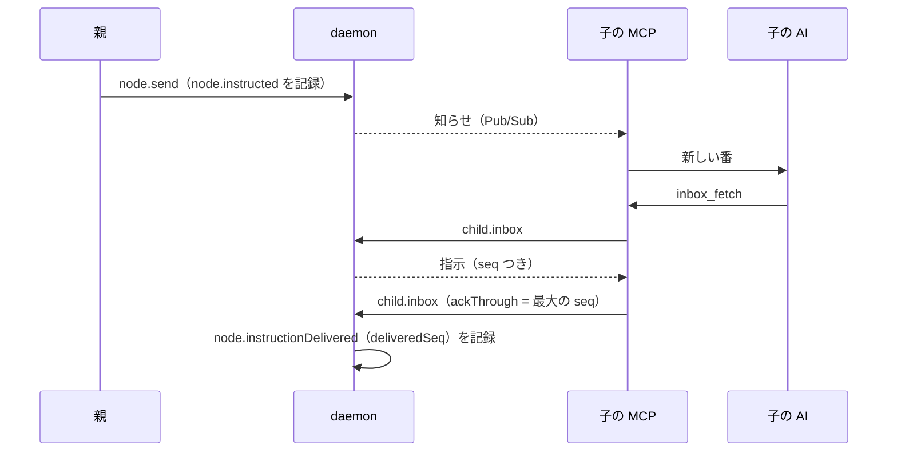

# Prompt Order Telegraph（指示の復唱） 設計下書き（Issue #261）

**関連 Spec:** [prompt-order-telegraph_spec.md](../../specification/prompt-order-telegraph_spec.md)
**関連決定ログ:** [touryou-261-prompt-order-telegraph.md](../../adr/touryou-261-prompt-order-telegraph.md)
**関連 PRD:** [prompt-order-telegraph.md](../../requirement/prompt-order-telegraph.md)

> 一時ドラフト。実装後、決まったことは ADR に統合して削除する。**未決は ADR にあり、ここでは選んでいない**。コードは変えていない。packages・plugin・docs は、ファイルの探索（`git grep`）で実在を確かめた範囲だけを根拠にしている。中身を読んでいないものは、7 章に書いた。

---

# 1. 実装ステータス

**ステータス:** 🔴 未実装（ドキュメントのみ）

| 項目 | ステータス | 備考 |
|:--|:--|:--|
| PRD・抽象仕様・ADR | 🟡 下書き | 未決あり |
| 実装 | 🔴 未着手 | 未決が決まってから、別の子に切る |

# 2. 設計目標

1. 親が、作業の結果を待たずに、指示の受領を確認できる（UR_POT_001）。
2. 復唱が、送った指示と食い違うとき、決定的に検出できる（FR_POT_003）。
3. 復唱に秘密を含めない（DC_POT_001）。既定はハッシュ値（決定済み）。
4. 既存の配送済み（`node.instructionDelivered`）・未達の知らせ（`cliWatch.unreadMinutes`）と矛盾・二重にしない。
5. 子の AI に新しい負担（ハッシュ値の計算・手順の暗記）を増やさない。

# 3. 技術スタック

既存の構成を変えない（TypeScript の pnpm モノレポ。`packages/core` が純粋なドメイン層、`daemon`・`mcp`・`cli` が外側。[CONSTITUTION.md](../../CONSTITUTION.md) A-001）。

| 領域 | 採用 | 理由 |
|:--|:--|:--|
| 照合の判定 | `packages/core` の純粋関数 | 決定的・テスト可能（NFR-POT-001。A-001） |
| 復唱の受け付け・記録 | `packages/daemon` | 単一の窓口。変更と同時に記録を残す（B-002） |
| 復唱の送信 | `packages/mcp`（子の MCP） | AI の判断を介さず計算するため（5 章の根拠） |
| ハッシュ | 標準の暗号ライブラリ（Node の `node:crypto`）。具体は未決 | 新しい依存を足さない |

# 4. アーキテクチャ

## 4.1. いまの流れ（確かめた事実）

出典: [touryou_design.md](../../specification/touryou_design.md) 138・194 行。`ackThrough` は、mcp が応答を受け取ってから呼び直す（応答が途中で切れたら印は付かず、次に同じものを返す）。

## 4.2. いまの仕組みで足りない所

| 足りない所 | 内容 |
|:--|:--|
| 内容の照合がない | 配送済みは番号の印だけ。受け取った文字列が、送った文字列と同じかは確かめない |
| 親への積極的な通知がない | 受領は記録されるが、親は、状態の問い合わせか画面を見ない限り知らない。受信箱に出るのは、30 分たっても受け取らないときの知らせだけ |
| 次の呼び出しまで印が遅れる | `ackThrough` は、mcp が次に `child.inbox` を呼ぶまで送られない |
| 取り違え・理解不能の知らせがない | 子が指示を理解できないときの専用の道がない（判断要求〔`report_decision`〕は人間向け） |

## 4.3. 経路の候補（選んでいない。ADR の未決 2）

| 案 | 内容 | 長所 | 短所 |
|:--|:--|:--|:--|
| A | 既存の `child.inbox` の呼び出し（`ackThrough`）に、MCP が計算した復唱（ハッシュ値）を足す | 新しい道具がない。AI の判断を介さない。受領の確認と復唱が 1 回で済む | 子の AI が「理解した」ことは示さない。MCP が呼び直すまで遅れる |
| B | 子の新しい道具（例: `instruction_echo`）を足す | 子の AI が明示的に返す。聞き返しも同じ道具に載せられる | AI がハッシュ値を計算できない（MCP が補う作りが要る）。道具が増える（NFR_004 の公開の最小化に反する） |
| C | 既存の `report_progress` に種別を足す | 新しい道具がない | 進捗の報告と意味が混ざる。受領の確認が AI の呼び出しに依存する |

`parent_report`・`parent_request` は、親のセッションに起動・停止・削除を依頼・報告する道具で、候補に入れない（仕様 1 章）。

## 4.4. 照合の方法（候補）

- daemon は、記録した指示の本文（`node.instructed`）から、復唱と同じ手順でハッシュ値を求め、受け取った復唱と比べる。**指示の記録の形を変えず**に済む（新しい項目を足すと、古い daemon がログを読み直せなくなる。#189 の `tokenIdleSoon` の前例）。
- 比べる前の正規化（改行・末尾の空白・引用の印 `> `）の規則が要る。親が送った文字列と、子の MCP が受け取って整形した文字列が、同じになる規則にする。**子の画面に出す形（各行の先頭の `> `）ではなく、記録された本文を対象にする**（子の MCP が、整形前の本文を持っているかは、MCP のコードを読んでいないので未確認）。

# 5. 設計の決定（下書き）

| # | 決定 | 理由 | 状態 |
|:--|:--|:--|:--|
| 1 | 復唱の既定はハッシュ値 | 利用者の決定。秘密を残さない（DC_POT_001） | **決定済み** |
| 2 | ハッシュ値の計算は、AI の判断を介さない仕組み（MCP）で行う | 言語モデルは、ハッシュ値を確実には計算できない | 下書き（方式の選択は未決 2 に従う） |
| 3 | 照合は core の純粋関数 | A-001・NFR-POT-001 | 下書き |
| 4 | 食い違いの検出は、記録された指示の本文から求める | 指示の記録の形を変えない | 下書き |
| 5 | 経路・待ち時間・不一致の後の扱い・聞き返し・紐付け切れの検出 | — | **未決**（ADR） |

# 6. テストの方針（下書き）

| 対象 | 方法 |
|:--|:--|
| 照合（core） | 純粋関数の単体試験。合う・合わない・復唱がない・同じ復唱の再送（冪等） |
| 未受領の見回り | 偽の時計を進める試験（既存の `cli-watch` の試験の形に合わせる）。既存の未達の知らせと二重にならないこと |
| 秘密を含む指示 | 復唱・知らせ・ログに、本文が現れないこと（NFR-POT-004）の検査 |
| 古い daemon | 新しい記録の種類を足す場合、古い版でログを読み直せない旨の記録（ADR）と、移行の方針 |

実機で確かめる項目は、#255 の調査 §6（[investigation.md](../255/investigation.md)）と同じ性質（手の空いた子が知らせで起きるか、など）。統括が確かめる。

# 7. 読んだ範囲と、読んでいない範囲

読んだ（`.sdd` の中と、`git grep` の出力の範囲）: `.sdd/AI-SDD-PRINCIPLES.md`・`.claude/rules/ai-sdd-instructions.md`・各テンプレート・`.sdd/requirement/touryou.md`・`.sdd/specification/touryou_spec.md`（1〜200 行）・`.sdd/specification/touryou_design.md`（138・179・194 行の出力）・`.sdd/adr/touryou-159-adopt-approval.md`・`.sdd/task/255/investigation.md`・`CHANGELOG.md` の #189・#195・#209 の項、`docs/config.md` の `cliWatch`、`docs/plugin.md` の関連行（`git grep` の出力）。

読んでいない（作業範囲の外、または中身を開いていない）: `packages/`・`plugin/` 配下のファイルの中身（探索の出力の行だけ）、`.sdd/specification/touryou_spec.md` の 200 行目以降、`.sdd/specification/touryou_design.md` の全体、`.sdd/adr/touryou.md`。これらに基づく記述は、書かない（ADR の「未確認」に残した）。
