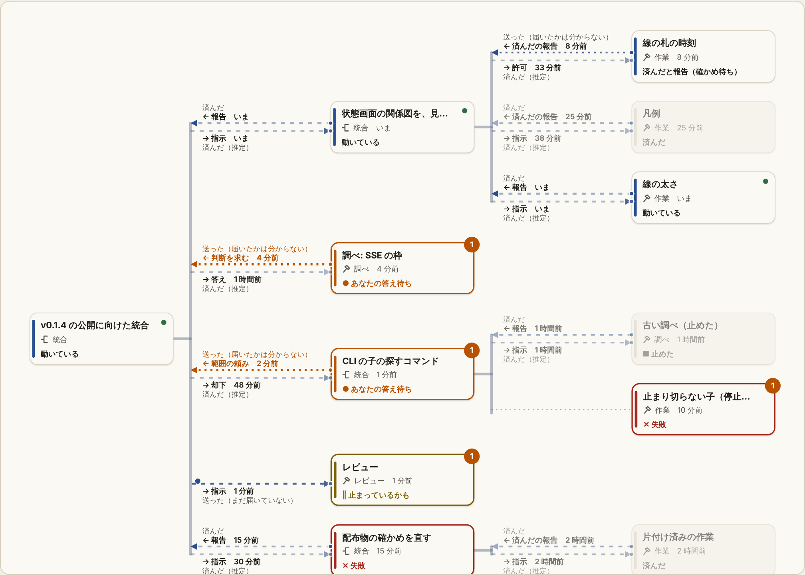
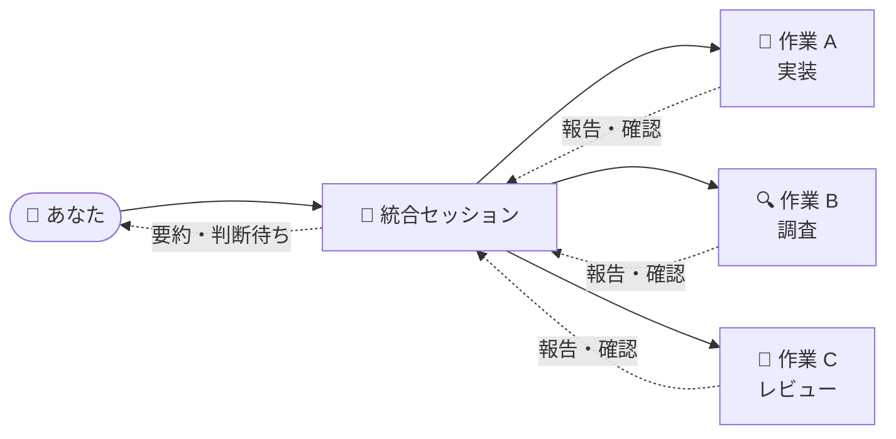
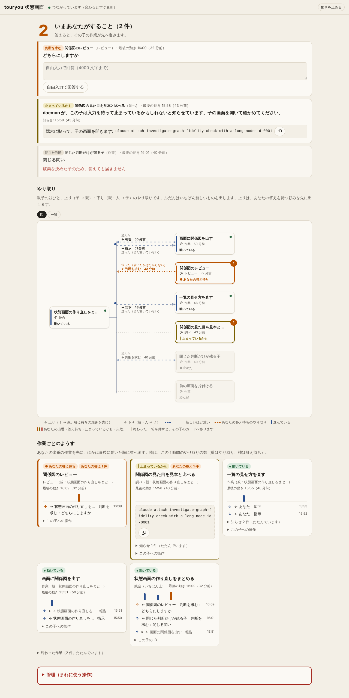
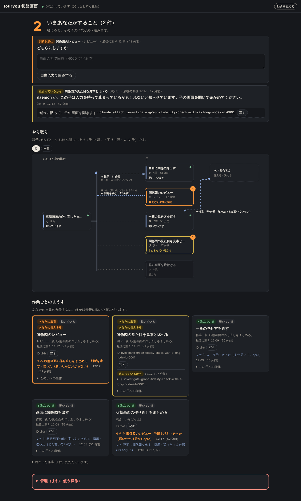

<p align="center">
  
</p>

<h1 align="center">TouRyou（統領）</h1>

<p align="center">
  <b>たくさんの Claude を、1 つの窓口から。</b><br>
  並列に進む実装・レビュー・調査を、あなたは統合セッションとだけ話して束ねます。
</p>

<p align="center">
  
  
  
</p>

<p align="center">
  
</p>

## しくみ



## はじめる

Claude Code で 3 行。

```text
claude plugin marketplace add comcreate/touryou
/plugin install touryou@touryou
/touryou:setup
```

終わったら、統合セッションで `/touryou:start`。画面を見るなら `/touryou:ui`。

> 必要なもの: macOS（Apple Silicon）・Claude Code・`git`（なければ `xcode-select --install`）。GitHub アカウントは不要です。

## できること

| | |
|:--|:--|
| 🌳 **木で束ねる** | 統合 1 に作業 n。進み具合が一目でわかる |
| 🔔 **判断だけ聞く** | あなたの答えが要るものだけ、受信箱に集まる |
| 🖥️ **状態画面** | 明るい・暗い、日本語・英語。ブラウザで開く |
| 🧹 **片付けも任せる** | 止める・回収する・消すまで、統合セッションが進める |

<table>
  <tr>
    <td></td>
    <td></td>
  </tr>
</table>

## コマンド

| コマンド | はたらき |
|:--|:--|
| `/touryou:setup` | 本体を入れる（最初の 1 回） |
| `/touryou:start` | 接続を確かめる |
| `/touryou:status` | 木の状態と未解決の項目を要約 |
| `/touryou:ui` | 状態画面を開く |
| `/touryou:service` | 常駐（supervisor）と daemon の確認・再起動・停止・外す |

## 常駐（supervisor）

常駐の項目は、macOS のログイン項目に出る **supervisor の 1 つだけ**です（Label `touryou.supervisor`）。supervisor が、登録簿（`$HOME/.touryou/registry.json`）に載った設定ごとに daemon を起こして見張ります。同じ設定の daemon がすでに動いていれば、起こしません（先勝ち）。supervisor を止めても、起こした daemon は止まりません。

- daemon の設定・状態・ログは、リポジトリごとの `<repoRoot>/.touryou/` に置きます。設定ファイルは、実行した場所から上へ `.touryou/config.json` を探して見つけます（[`docs/config.md`](docs/config.md)）。
- 操作は `/touryou:service`、または `touryou supervisor`（`status`・`restart`・`stop`・`register`・`unregister`・`uninstall`。対象は `--config <設定>` か `--all`）。
- 版を上げる（`/touryou:setup`。同意を 1 回取る）と、supervisor を読み込み直し、登録簿のすべての daemon を、新しい版で起こし直します（30 秒以内）。手で起こした daemon は止めないので、端末で止めてから、supervisor に起こさせてください（`/touryou:service restart`）。

仕組みと既知の限界は [`docs/launchd.md`](docs/launchd.md)。

## 更新

```text
claude plugin marketplace update touryou
claude plugin update touryou@touryou --scope user
```

Claude Code を開き直して、もう一度 `/touryou:setup`。

新しい版が見えない（`already at the latest version` のまま）ときは、marketplace が古い tag に固定されているかもしれません。`claude plugin marketplace list` で touryou の Source を見て、`@marketplace-v0.1.6` のように `@marketplace-v<版>` が付いていたら、その tag を取り直すだけで上がりません。直し方は [`docs/plugin.md`](docs/plugin.md) の「新しい版」（user の設定の `extraKnownMarketplaces.touryou.source` の `ref` を新しい版の `marketplace-v<版>` にして、`claude plugin marketplace add "comcreate/touryou#marketplace-v<新しい版>"` をし直す）。公開の直後は、反映が済むまで見えないこともあります。そのほかのうまくいかないときも [`docs/plugin.md`](docs/plugin.md)。

## 知っておくこと

- 1 人で使う Mac 専用です。
- Desktop の子（`childRuntime: "desktop"`）は実験的です。信頼できない入力は読ませないでください（[`docs/desktop-runtime.md`](docs/desktop-runtime.md)）。
- TouRyou はセッションの起動も Anthropic の認証も扱いません。Anthropic の公式製品ではなく、Anthropic とは関係がありません。

## もっと

📘 [開発者向け](DEVELOPMENT.md)　·　🤝 [貢献](CONTRIBUTING.md)　·　📝 [変更履歴](CHANGELOG.md)　·　🔒 [セキュリティ](SECURITY.md)　·　⚖️ [MIT](LICENSE)
