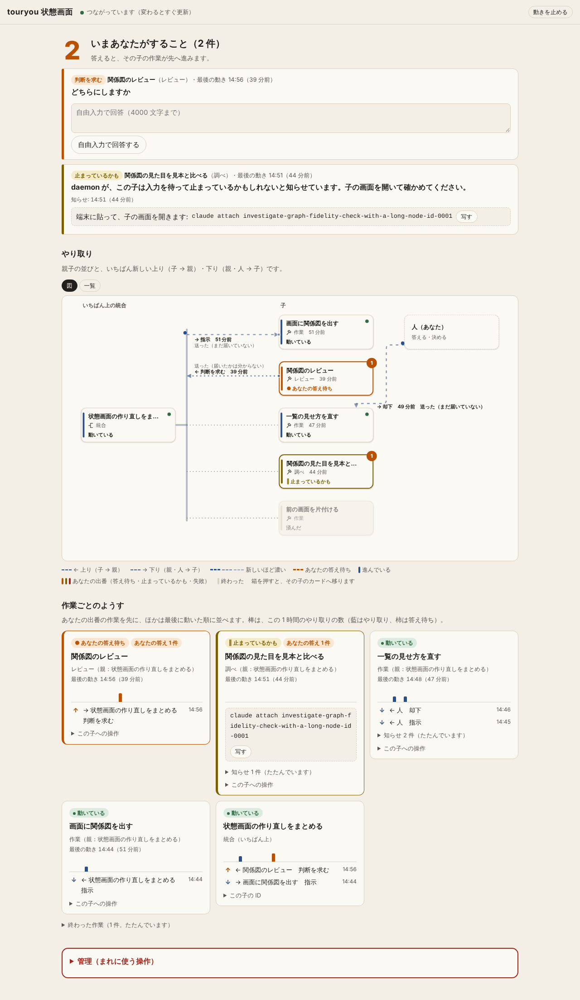
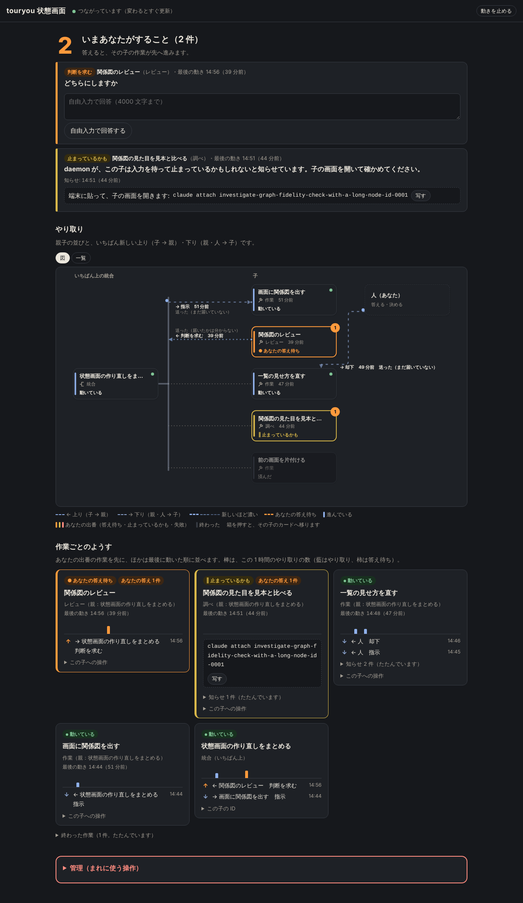

# HTML 画面（FR_021・IR_003・NFR_008）

daemon の窓口が、状態を見るための HTML 画面を配る。**状態を見ることと、判断への回答・拡張要求の判定・破壊的な操作・回収の指示。**依存は増やさない（素の JavaScript。資産は TS の文字列として埋め込む）。

| 明るい画面 | 暗い画面 |
| --- | --- |
|  |  |

## 入口

| パス | 認証 | 内容 |
| --- | --- | --- |
| `GET /ui` | なし | HTML（状態を含まない） |
| `GET /ui/app.js`・`GET /ui/app.css` | なし | 画面の JS・CSS |
| `GET /ui/graph.js` | なし | 関係図の束（#89。下の「関係図の束」。HTML が `app.js` のあとに読む） |
| `GET /v1/ui/state` | 人間のトークン・画面のセッションだけ（それ以外は 403） | 表示モデル（`uiViewOf`。`{ok:true,value}`） |
| `GET /v1/events` | 人間のトークン・画面のセッションだけ（それ以外は 403） | SSE（変更の通知。下の「更新（SSE）」） |
| `POST /v1/ui/ticket` | `human-token` だけ（画面のセッション・ノードは 403） | 画面を開くチケット `{ok:true,value:{ticket}}`（60 秒・1 回だけ） |
| `POST /v1/ui/session` | なし（本文 `{ticket}` が資格） | 画面のセッションのトークン `{ok:true,value:{session}}` |

**静的な資産（`/ui`・`/ui/app.js`・`/ui/app.css`・`/ui/graph.js`）には、回数の制限をかけない**（状態を含まず、認証もないため。`/v1/ui/state` は、主体ごとの回数の制限の対象）。

どれも、既存の Host・Origin の検査（`127.0.0.1:<port>`・`localhost:<port>` だけ。DNS rebinding 対策）を通る。待ち受けは 127.0.0.1 だけ（変更なし）。

## 認証（人間のトークン）

- **推奨: `/touryou:ui`（Claude Code）か、Mac のターミナルで `touryou ui`（`$HOME/.touryou/current/bin/touryou ui`）。** 貼り付けなしで、既定のブラウザに開く（#88）。
  1. `touryou ui` が、`$HOME/.touryou/config.json`（または `TOURYOU_DAEMON_CONFIG`）の `stateDir` から、`port` と `human-token` を自分で読む（`TOURYOU_HUMAN_TOKEN` は要らない）。
  2. daemon の身元を確かめる（`docs/daemon-identity.md`。今の `touryou` コマンドと同じ）。合わなければ、トークンを送らずに止まる。チケットの応答の `x-touryou-daemon-id` も、確かめた daemon と照らす。
  3. `POST /v1/ui/ticket` でチケットをもらい、`http://127.0.0.1:<port>/ui#ticket=<チケット>` を `open` で開く。**`ps`・ブラウザの履歴に残るのは、このチケットだけ**（60 秒・1 回だけ）。トークン・チケット・URL は、標準出力・標準エラーに出さない。
  4. 画面は、読み込んだ**最初に**フラグメントを取り出して `history.replaceState` でアドレスから消し、`POST /v1/ui/session` で、画面のセッションのトークンに交換する。チケットは、交換を試みた時点で（成否によらず）消える。
- **画面のセッション**: `human-token` とは別の値。画面のメモリにだけ置く（localStorage・sessionStorage・cookie には置かない）。**再読み込みしたら、`/touryou:ui` でもう一度開く。** 使わないと 1 時間・発行から最長 12 時間で切れる。daemon のメモリにだけあるので、**daemon を起動し直すと、すべて切れる**。できることは人間と同じ（取り消せない操作は、今までどおり ID の打ち込みの確認つきで、daemon の確認待ちも経由する）。チケットはもらえない（`human-token` だけ）。
- **チケットの拒否**: 誤り・期限切れ・使用済みは、同じ 401 と同じ文面で断る。本文は `application/json` だけ（ほかは 415）。失敗は接続元ごとの認証の失敗の制限（`docs/rate-limit.md`）で数え、尽きている間は、照合せずに 429（`Retry-After`）。接続元は 127.0.0.1 だけなので、この制限は実質、全体で 1 つ（同じ端末の別のプログラムが誤りを送り続けると、本物の交換も 429 になる）。画面が開けなかったときは、少し待ってから `touryou ui` をやり直す。
- **セッションが切れたとき**: 画面は「画面のセッションが切れました…`/touryou:ui`（または `touryou ui`）で開き直してください」と出して、未接続に戻る。
- **入口**: 画面のセッションが通るのは、`/v1/request`・`/v1/ui/state`・`/v1/events`・`/v1/whoami` だけ。フックの入口（`/v1/hook`）は通らない。記録（イベント）の行為者は、`human-token` の操作と同じ人間のまま。窓口のログには、画面のセッションで受けた `/v1/request` ごとに `uiSessionRequest`（`requestId`・`operation`・時刻だけ。値は書かない）を残し、`touryou` コマンドの操作と見分けられる。
- **ブラウザを開けないとき**（Claude Code がクラウドで動いている・macOS でない など）: `touryou ui` は、URL を出さずに「Mac のターミナルで `touryou ui` を実行してください」と出して止まる。
- **予備: ページに貼り付ける。** 人間のトークンのファイルの中身を、`/ui` を開いて出る入力欄に貼る。メモリにだけ置く。リロードすると、また貼る。
- **`/ui#token=…` は外した**（長く使えるトークンを URL に載せる道のため）。付けて開いても、フラグメントは消されるだけで、接続しない。
- 以後の通信は `Authorization: Bearer` の header だけ。cookie を使わないので、CSRF の経路はない（操作も同じ）。

## 表示モデル（`uiViewOf`）

- 含める: ノード（`id`・役割・親・状態・依存・未解決の項目の数）（画面は、**状態が受理・回収可・アーカイブのノードには、「要対応」の数を出さない**〔`SETTLED_STATES`。対応することが残っていないため。停止〔`stopped`〕は、回答して再開・破棄して回収など、人が決めることが残りうるので出す。項目そのものは受信箱に出る〕）、未解決の受信箱の項目（優先度の降順）、未回答の判断（質問・選択肢）、未判定の拡張要求（理由と、表示してよい対象。下の「拡張要求の対象」）。
- #89 で足した値（画面はまだ使わない。PR-4・PR-5 で使う）: ノードの `title`（目的の改行・タブ・続く空白を空白 1 つにまとめて 1 行にし、先頭を `UI_TITLE_MAX`＝80 コードポイントで整えて切る）・`lastActivityAt`（報告・受信箱・指示と受け取り・判断と拡張の要求のうち最も新しい時刻）・`needsHuman`（未回答の判断・未判定の拡張要求・未解決の「止まっているかも」と停止未完了の数）・`band`（`turn`・`running`・`finished`）、受信箱の項目の `ref`・`stall`、拡張要求の `at`、やり取りの `flows`（新しい順に 200 件まで。種類・向き・`from`・`to`・段 `sent`・`delivered`・`done`・時刻・`deliveryUnknown`・`doneInferred`。本文は載せない）。
- **含めない: トークン・秘密・パス（作業ツリーの絶対パス・最終コミット）・ブリーフ（受け入れ基準と、目的の題より後ろ）。** 試験で、これらの文字列が出ないことを確かめている。
- 子が書いた文字列は、制御文字（タブ・改行は残す）と書式制御文字（U+202E・ゼロ幅など）を除いて、**種類ごとの上限**（コードポイント）に切る: 要約・理由は 200、**判断の質問は 2,000**、**選択肢は 500**（サーバーの選択肢の上限と同じ）。切ったときは、末尾に「…（省略）」を付ける（印は上限に数えない）。識別子の形でないものは空にする。
- **選択肢は、回答の `choice` に、そのまま送る文字列**なので、切った・文字を除いたものは、そのままでは送れない（`options[].truncated`）。画面は、そのボタンを無効にして、「長すぎるため、自由入力で回答してください」と表示する。選択肢が 10 個を超えるときも（`optionsCut`）、同じ案内を出す。
- 件数の上限（ノード 500・項目 200・判断 100・拡張要求 100・やり取り 200）を超えたら切って、`truncated` に種類を入れる。画面は、`truncated` があるか、木に描けなかったノード（深さの打ち切り・親をたどれないもの）がある場合も、「一部省略」と表示する。人間のトークンでないもの（403）は、「人間のトークンが必要です」と表示し、401（トークンが正しくない）と分ける。

## 更新の効率（ETag）

`/v1/ui/state` は、`lastSeq` を鍵に、直近の 1 件の表示モデル（JSON）を使い回す（同じ `lastSeq` なら、作り直さない）。`ETag: "<lastSeq>"` を付け、`If-None-Match` が一致すれば 304（本文なし）。認証・ロールの検査は、304 の前に行う。画面は、前回の ETag を送り、304 なら描き直さない。

## 操作

画面から、**判断への回答（`decision.answer`）と、拡張要求の判定（`scope.decide`）だけ**ができる。人間のトークンで、既存の `POST /v1/request` に送る（新しい入口はない。`decision.answer`。認可は、daemon の既存の検査〔人間のロール〕に任せる。画面の出し分けは、表示上のもの）。

選択肢のボタン、または自由入力。自由入力は、画面で、空・空白だけ・4,000 文字超・制御文字（タブ・改行以外）・書式制御文字（U+202E・ゼロ幅など）を拒む（制御文字・書式制御文字は、サーバーの検証〔`isBoundedText`〕と同じ規則。上限は、サーバーの 64 KiB より厳しい 4,000 文字。子に渡る文なので）。判定の部分（`checkAnswer`・`describeFailure`・`waitSecondsOf`）は、`vm` で評価する単体テストがある（`ui-assets.test.ts`）。複数行は使える。入力中の文は、状態が更新されて再描画されても残る。

**確認と二重送信。**
- 押すと、すぐには送らず、「確認」の表示になる。**確認の欄はページの上にあるので、開いた直後に、欄まで動かし（`scrollIntoView`）、フォーカスを欄の中（打ち込みの欄。なければ「この内容で送る」、押せなければ「戻る」）に移す**（下のボタンを押したとき、何も起きないように見えないように）。結果の通知（`#notice`）も、出すときに見える所まで動かす。判断の内容（ノード・質問）と、これから送る回答（選んだ選択肢・入力した全文）を、もう一度見せて、「この内容で送る」「戻る」を出す。
- 回答の結果に、再開しなかった子（`notResumed`）があれば、成功の通知に「回答を送りました。再開しなかった子: a（理由）、…」と出す。理由は固定の記号を固定の文に写す（`discarded`: 破棄の判断を経たため／`stoppedAfterStopIncomplete`: 停止未完了のあと止め直したため。新しい子でやり直す／`stoppedByOther`: 判断のほかに止められたため。知らない記号は「理由は不明」）。ID は `ID_RE` に合うものだけを出し、`textContent` で描く。10 件で切り、残りは「ほか N 件」と出す（ほかの一覧とそろえる）。`stoppedAfterStopIncomplete` は、判断の要求のあと、停止未完了を経て止め直された（retryStop）子。回答が失敗（`resumePending`）のときは、画面に再開しなかった子の通知が出ないことがある。受信箱の `info` には記録される。
- 確認を出すたびに、`requestId`（`crypto.randomUUID()`）を新しく作る。その確認の間は、同じ ID で再送する（既存の重複排除で、同じ要求は、二重には実行されない）。送っている間は、ボタンを無効にする（二重クリックでも、要求は 1 回）。
- 失敗したら、`code: cause` を表示して、確認に戻る。**同じ内容の再送を案内するのは、待てば通りうるもの（429・ネットワークの失敗。同じ `requestId` なので、二重には実行されない）だけ**。判断の失敗（4xx。別の人が先に回答していた、など）は、同じ内容を送り直しても結果が変わらないので、「戻る」で状態を確かめるよう案内する。先端の不一致（`tipMismatch`・`tipUnknown`）は、確かめ直しを案内する。429 は、`Retry-After` の秒数（なければ 5 秒）のあいだ、「この内容で送る」を無効にし（「あと N 秒待つ」。時間が来たら、自動で押せるようになる）、自動の再送はしない。成功したら、確認を閉じて、状態をすぐに取り直す。

**CSRF。** cookie を使わず、`Authorization: Bearer`（メモリのトークン）と `Content-Type: application/json` で送る。別のオリジンのページからは、Origin の検査（403）で拒まれ、フォームから送れる形（`text/plain` など）は 415 で拒まれる（`ui-operations.test.ts`）。操作は、主体ごとの回数の制限の 1 要求として数える。`<form>` は使わない（トークンの入力欄だけ。`form-action 'none'` の CSP がある）。

### 拡張要求の対象

- 各拡張要求に、**承認・却下・切り出し**のボタンを置く。押すと、判断への回答と同じ、確認（ノード・種類・対象・理由・判定）→ 送信の 2 段になる（`requestId` は確認ごとに新規。二重クリック・429・失敗の再送も同じ）。params は `extensionId` と `decision` だけ。**許可する対象（`granted`）は、画面から送れない**（余計なキーは 400）。daemon が、**記録済みの対象をそのまま許可する**ので、画面に出した対象と、実際に許可される対象は一致する。
- 表示モデルの対象（`kind`・`target`・`targetHidden`）は、**表示してよいものだけ**を出す（`uiTargetOf`）。write は作業ツリー内の相対パス、command は**許可リスト**（`^[A-Za-z0-9._:@%+=,/ -]+$`）に合うコマンドだけ。次のものは、**切らずに隠す**（値を出さず `targetHidden`）: 絶対パス（write は `/`・`\`・`~`・ドライブ・スキームの先頭。command は、単語の先頭〔先頭・空白・`=`・`,`・`:` の直後〕の `/` と、`-I/usr/lib` のような短いオプションに続く `/`。許可リストにない文字〔`$`・バッククォート・`{}`・引用符・`~`・`\`・`;|&<>()`・`*` など〕を含む command は、すべて隠す）、`..` の区間、制御文字（タブ・改行も）・書式制御文字、空、先頭か末尾に空白がある、200 コードポイント超（切った値を承認すると、別の対象を許可してしまうため）。
- **隠れた対象は、承認・切り出しをさせない**（ボタンを無効にし、理由を出す）。却下だけ押せる（注意書きに、「子に、相対パス・単純なコマンドで要求し直すよう依頼する」案内が出る）。切り出しの確認には、「この対象は許可しない。子には、作業を切り出して進めるよう通知される」と出す。「隠れていなければ、`target` は元の値と完全に同じ」という性質を、網羅した入力と擬似乱数の入力で確かめている（`ui-view.test.ts`）。拡張要求の件数は 100 まで（超えたら `truncated`）。描画は `textContent` だけ。

### 回収の指示（人間による破棄の判断）

木の行のうち、**状態が `stopped` のノード**に「破棄して回収を指示…」を出す（daemon のハンドラが、`stopped` だけを受けるのと合わせる。統合済みで検証済みのノードは、破棄でなく通常の回収なので、画面には出さない）。破棄の判断が記録済みのノード（表示モデルの `discarded`）には、ボタンの代わりに「破棄を指示済み（回収は統合ノードが行う）」を出す。`node.reclaimInstruct` は、停止したノードの作業ツリーとブランチを**強制して消す**判断なので、取り消せない。cli の `touryou reclaim`（`docs/reclaim-loss.md`）と同じ照合を、画面でも行う。

1. **事前確認**: 押すと、まず `node.reclaimPreview`（読み取りだけ。`readOperationResult`）を呼び、結果を確認に出す: 対象・「破棄の判断は取り消せない。記録されるのは、この対象だけ（配下の停止ノードは、別に指示が必要）」・満たしていない条件（`unmet`）・原因（プロセスの pid とコマンドの名前・ノード ID。**パスは出ない**。名前は lsof の `c` の欄〔コマンドの名前だけ。引数・パス・環境変数は含まない〕から取り、core の `processCommandName` で制御文字・書式文字を除いて 32 文字までにする。画面でも整えて `textContent` だけで描く）・**失われるもの**（ノードごとの、統合されていないコミットの数・件名・追跡中の未保存の変更・未追跡のファイルの数。件名は**信頼できない入力**なので、制御文字を除いて 1 行にし、`textContent` だけで描く）・ブランチの先端（先頭 12 桁。cli の表示と見比べられる）。**失われるもの・先端は、20 件で切り、「ほか N 件」を出す（先端は、すべて照合に含める）。満たしていない条件・原因は、10 件で切り、「ほか N 件」を出す。**「失われるもの」は、この対象と配下のもので、配下は、それぞれの指示のときに失われる。
2. **先端の照合（cli の `--expect` に相当）**: **確認で見せたプレビューの `tips` を、作り直さずに、そのまま `expectTips` として送る**（`startReclaim` は、確認を出す前に 1 回だけプレビューを呼び、取り直す経路はない。走査の試験で確かめている）。daemon が、今の先端と照合し、違えば**何も記録せず** `tipMismatch`（先端を取れないときは `tipUnknown`）。画面は、この 2 つのとき、「表示したあとで、先端が変わった。何も指示していない。もう一度、『破棄して回収を指示…』から、内容を確かめ直す」と案内する（同じ内容の再送は、何度送っても通らないので、案内しない）。やり直すと、新しいプレビュー・新しい `requestId` になる。cli のような照合の値（12 桁のダイジェスト）は、画面では持たない（cli は、表示と指示が別々の実行なので、人間に値を持たせる。画面は、確認を出したページが、見せた内容を持っている）。
3. **強い確認（打ち込み）**: **対象のノード ID を、完全に一致するまで打ち込ませる**（打ち込む文字列は、1 回のクリックで全体が選ばれる表示〔`user-select: all`〕なので、コピーして貼り付けてよい。手で長い ID を打たなくてよい）（`typed`。前後の空白・大文字小文字・全角の違いは不一致。送る側にも同じ検査があり、画面の無効化を迂回しても送らない）。
4. **送れない（blocked。フェイルクローズ）**: 次のときは、理由と「cli（`touryou reclaim <ノード ID>`）で確かめる」案内を出して、打ち込みの欄も出さず、送らせない: ①事前確認が失敗した、②`loss` がない（古い daemon）、③**どれかのノードの `loss` が `unknown`・`workingTreeUnknown`**（失われるものを調べられなかった。cli は警告だけで通すが、画面は、失われるものが分からないまま、取り消せない指示を出さない）、④`tips` が 256 件（`LIMITS.expectTips`）を超える。
5. **成功のあと**: 「破棄を指示しました。実際の回収は、統合ノードが行います」（`node.reclaim` が、記録を見て、強制して消す）。

通信・認可・CSRF・回数の制限は、これまでと同じ（`POST /v1/request`・人間のトークン・Origin の検査）。

### 破壊的な操作

画面の下に、2 つの節がある。どちらも、既存の操作を `POST /v1/request` で呼ぶだけ（新しい入口・契約の変更はない）。通信は `callOperation` の 1 か所だけ（確認ありの送信 `sendPending` と、読み取りの `readOperationResult` が使う。走査で、`fetch('/v1/request'` が 1 か所であることを確かめている）。

- **最終削除（アーカイブ済みの木）**: アーカイブ済みで、親がないか、親がアーカイブされていないノード（`purgeRoots`）を、根として並べる。
  - 「最終削除…」「墓標を残さずに最終削除…」: 押すと、まず `node.purgePreview`（読み取り）を呼び、結果を確認に出す: 削除されるノード（20 件まで。超えた分は「ほか N 件」）・アーカイブ日・経過日数・保持期間・墓標（タイトルは信頼できない入力なので整形）・一緒に消える保管の数・**保留中なら「保留は自動の削除だけを止める。この最終削除は、保留を無視して消す」**・実行できない理由（`blockers`）。実行できないとき（`purgeable` でない）は、理由を出して、送れない。
  - **打ち込みの確認（取り消せない操作）**: 木の根の ID を打ち込ませ、**完全に一致するまで「この内容で送る」を無効にする**（`typedMatches`。前後の空白・大文字小文字・全角の違いは不一致）。送る側（`sendPending`）にも同じ検査があり、画面の無効化を迂回されても送らない（vm で `sendPending` を評価する単体試験と、実ブラウザで「`disabled` を外してクリックしても、要求が出ない」ことを確かめている）。打ち込みの欄は `textarea`（貼り付けでも通る）。
  - params は `nodeId`・`expectNodeIds`（**確認で見せた、削除されるノード**）と、墓標を残さないときの `tombstone: false`。**見せたあとで木が変わっていたら（ノードが増えた・減った）、daemon が何も消さずに `purgeStale` で失敗する**（木がもうないときの、同じ requestId の再送は、照合せずに最初の結果を返す）。ノードが 2000 件（`LIMITS.expectNodeIds`）を超える木は、画面から送らない（確認に理由を出す。cli では、daemon の照合を省いて送れる。下）。cli の `touryou purge` は、まだ `expectNodeIds` を渡さない（省略すると照合しない。今後の課題）。
- **自動の最終削除の保留**（取り消せる操作。打ち込みなしの通常の確認）: 「無期限・30 日・90 日」と、任意の理由（200 文字まで。制御文字は不可。入力中の理由は、木の一覧が描き直されても残る）。確認に、**今の保留の状態と期限**（事前確認の `hold`。取れなければ「取得できなかった」）を出す。期限は、この 3 つと、**日数の指定**（「指定した日数で保留…」。1〜365 の整数。cli の `touryou purge-hold --days` と同じ）。**どれも `days` を daemon に送り、期限は daemon の時計で決める**（端末の時計のずれに左右されない。10 分の短縮も要らない。365 日のときだけ、daemon が 1 秒短くする）。確認には「保留した時点から N 日後」と出し、**実際の期限は、保留した直後の通知「保留しました（ID）。期限: …」に出る**（daemon が決めた値。無期限なら「無期限」）。`days` は、この版以降の daemon が必要（古い daemon は 400。画面は、daemon と同じ版で配られる）。`until` は送らない（`node.purgeHold` は `until` も受けるが、`days` と同時には指定できない）。「保留を解除…」もある。
- **破棄した成果の保管**: 「一覧を読み込む」で `node.discardedList` を呼ぶ（**自動では更新しない**。SSE の対象外。取り出す・消すのあとは、読み込み直す）。名前・ノード（なければ孤立）・先端（先頭 12 桁）・日時・件名（**信頼できない入力**。daemon の整形に加えて、画面でも制御文字を除き、`textContent` だけで描く）を出す。
  - 「ブランチに取り出す…」: `node.discardedRestore`（`target` だけ。**ブランチ名は入力させない**。既定の `touryou/restored/<key>`。既存のブランチは上書きしない）。取り消せるので、通常の確認。
  - 「保管を消す…」: `node.discardedDrop`。**保管の名前（key）を打ち込ませる**。**一覧で見せた先端を `expectTip` として渡す**ので、見たあとで先端が変わっていたら、daemon が消さない（`tipMismatch`）。
- 確認の共通の部品: `openConfirm(title, lines, operation, params, done, opts)` の `opts` に、`typed`（打ち込ませる文字列）・`blocked`（送れない理由）・`after`（成功のあとの処理）を指定できる。回収の指示も、これを使う（上の節）。読み取りは、`readOperationResult(operation, params)`（`{ ok, value }` か `{ ok: false, error: { code, cause, status } }`。通知は出さない。`tipMismatch` などの失敗の種類を、呼び出し側が区別できる。ネットワークの失敗は `code: 'network'`）と、通知を出す `readOperation`。失敗の通知は赤（`.notice.bad`）。保管の確認の行は `cleanText` を通し、ID の形でない key には、操作を出さない。

### 取り消せない操作の確認待ち（Desktop の木）

表示モデル（`/v1/ui/state`）の `confirmations`（確認待ち。コードは含まない。Desktop の木でだけ出る）を、ページの**いちばん上に固定した欄**（`#approvals`。`position: sticky`）に出す。スクロールしなくても見え、新しい確認待ちが出たら、コードの入力欄にフォーカスする（確認の欄を見落とさないため）。行は、操作・対象・確認の番号の先頭（端末の行と見比べる）・期限と残りの回数（`approvalLines`。`textContent` だけ）。「確認して実行する」で `confirm.approve`（`{ confirmationId, code }`）、「取り消す」で `confirm.cancel`。失敗の理由は、欄の中と、**ページ全体の通知（赤）**の両方に出す（5 回目の誤り・期限切れ・実行のあとの失敗では、確認待ちが消えて欄の中の理由が描かれないため）。人がほかの入力欄で打っている最中は、新しい確認待ちが出ても、フォーカスを移さず、スクロールもしない。確認待ちの変化は、記録の seq を変えないので、表示モデルの ETag と SSE の通知に、確認待ちの版の数を足している。画面の「最終削除…」などの確認から送ったときも `confirmationRequired` が返り、確認の欄に「いちばん上の確認待ちの欄に、端末のコードを打つ」と出る。仕組みは [`docs/desktop-runtime.md`](desktop-runtime.md) の「取り消せない操作の確認」。

### 停止の宣言

木の行のうち、**状態が `stopIncomplete` で、表示モデルの `stopDelegated` が真のノード**（daemon が直接止められず、親に停止を代行してもらうノード。CLI の子・Desktop の子）に、根拠の入力欄（任意。200 文字まで）と「止めたと宣言…」を出す。押すと確認を出し、**対象のノード ID を打ち込ませる**（取り消せない。`node.confirmStopped`。`docs/desktop-runtime.md`）。根拠は信頼できない入力なので、確認の表示では `cleanText` で整え、`textContent` で描く。cli では `touryou confirm-stopped <nodeId> [--note <根拠>]`。

受信箱では、`stopDelegated` のノードの `stopIncomplete` の項目を、赤の「失敗」でなく、**「停止の代行依頼」**（灰色の帯）として出し、「親（または人）が止めてから、木の『止めたと宣言…』で知らせる」と添える（決まった手順の依頼で、失敗ではないため）。根に出る、Desktop の子を人が確かめる依頼（daemon の再起動のあとの整合。`external-check.ts` の固定の文面〔今の版と前の版〕で始まる `stopIncomplete`）も、同じ灰色の扱いにし、「Desktop で子ごとに確かめ、止まっていれば『止めたと宣言…』で知らせる」と添える。daemon が直接止めるノードの `stopIncomplete` は、これまでどおり「失敗」。

`stopDelegated` は、daemon がアダプタの能力表から埋める（`ApiDeps.stopDelegated` → `uiViewOf(state, { stopDelegated })`）。表示のキャッシュは `lastSeq` を鍵にするので、能力表がアダプタごとに固定であることが前提。能力表が記録なしに変わりうるようになったら、キャッシュの鍵を見直す。いまは、CLI の子・Desktop の子のどちらのアダプタも `stopDelegated` が真なので、`stopIncomplete` の子に出る。

### フックの結び付けを外す

木の行のうち、**統合ノードでなく、状態が `running`・`waiting` の子**に、「フックの結び付けを外す…」を出す（止まったノードには、フックが来ない）。押すと確認（2 段）を出し、送ると `node.hookUnbind`（`{ nodeId }`）を呼ぶ。**打ち込みはない**: 外しても失うものがなく（次に来たセッションに結び直すだけ）、外した者（人間）が記録 `node.hookUnbound` に残るため。確認には、トークンが漏れた疑いがあるときは外さずに子を止めてトークンを失効させる、という注意を出す。結果は 3 通り（外した・結び付けがなかった〔記録だけ残した〕・すでに記録済み〔再送〕）。cli では `touryou hook-unbind <nodeId>`（`docs/plugin.md` の「フック」）。

**結び付けの有無は、画面に出さない**: 結び付けは daemon のメモリだけにあり、最初のフックの呼び出しで、イベントなしに変わる。表示モデルのキャッシュ（ETag）と SSE の通知は `lastSeq` で更新するので、出すと古い表示になる。session_id も出さない。

## 入力欄

入力欄（`textarea`）は、すべて `field(name)` で作り、`name` と、ページの中で一意な `id` を付ける（ブラウザの自動入力・支援技術が欄を区別できるように。トークンの欄は `name="token"`）。

## 画面の組み立て（#89）

上から順に、次のとおり（決めは `.sdd/task/issue-89/research.md` の 7 節、設計は `design-draft.md`、見た目は `mock.html`）。

- **上の 1 行**: 題と、つながりのようす（「つながっています（変わるとすぐ更新）」・「2 秒ごとに確かめて更新」・数が多くて一部を省いたとき）。「動きを止める」のボタン。
- **確認待ち**（いちばん上に固定）と、操作の確認の欄（今までどおり）。
- **いまあなたがすること**: 人の操作が要るものの数（大きな数字）と一覧。判断の頼み（選択肢のボタン・自由入力）、範囲を広げる頼み（承認・却下・切り出し。押すとどうなるかの説明つき）、**daemon が止まっているかもしれないと知らせた子**（受信箱の `stall` があるときだけ。時刻の経過などから画面で推し量らない）、停止の代行依頼（止めたと宣言…）。それぞれに、誰から（題・役割・最後の動き）を添える。止まっているかもしれない CLI の子には、`claude attach <ノード ID>` と写すボタンを出す（CLI の子は `--name <ノード ID>` で起動している。セッションの ID は出さない）。Desktop の子には、Desktop で開いて確かめる文を出す。なければ「いま、あなたがすることはありません」。答えても届かない閉じた判断は、理由を示して最後に出す（数えない）。
- **やり取り**: 木の字下げの一覧と、それぞれの子の最後の上り（子 → 親）・下り（親・人 → 子）。段は「送った（まだ届いていない）」「送った（届いたかは分からない）」「届いた（返事を待っている）」「済んだ」「済んだ（推定）」。答え待ち（判断・範囲の頼みで済んでいないもの）だけ柿色。「詳しく」で、その子のカードへ移る。関係図は `#graph` の場所に描く（PR-5）。
- **作業ごとのようす**（見本 `mock.html` の「作業ごとのようす」の `cards`・`spark`・`flowlist`）: 子 1 つを 1 枚のカードにする。あなたの出番（`band: turn`）を先に、ほかは最後に動いた順。カードの頭の札は、状態の札 1 つ（図の箱の 3 行目と同じ印と言葉。`/ui/graph.js` の `statuses` から取り、読めないときは状態の名前）と、答えがあれば「あなたの答え N 件」（`needsHuman`。進み具合・済んだ・知らせは数えない）だけ。答えのあるカードは縁を柿色にする。その下に、題（`h3`）・役割と親の題・最後の動き（手元の時刻と経過）、この 1 時間のやり取りの棒（5 分ずつ 12 区切り。藍はやり取り、柿は答え待ち。`div` で組み、高さは数の段のクラス）、最近のやり取り 3 件（↑ 上り・↓ 下り、答え待ちは柿色。「→ / ← 相手の題　種類」と時刻。やり取りの本文は表示モデルにないので出さない）。止まっているかもしれない CLI の子は、`claude attach <ノード ID>` と「写す」を出す。受信箱の項目は「知らせ N 件（たたんでいます）」（終わった作業は「済んだ作業の知らせ N 件」）にたたむ（中身は新しい順。種類は利用者の言葉。長い文は開いて全文を読む）。ID と「写す」は、たたんだ「この子への操作」（操作がない子は「この子の ID」）の中に出す。操作には、ボタンごとに、何をするか・取り消せるかを添える。終わった作業（`band: finished`）は、たたんだ「終わった作業」の欄へ。
- **管理**（たたんだ欄）: アーカイブした作業の最終削除と、自動の削除の保留、捨てた作業の保管。取り消せない操作は、今までどおり対象の ID を打ち込ませる。
- **動き**: CSS の `@keyframes` とクラスの付け外しだけ。新しく来た項目が入ってくる動き・数が変わったときの動き・動いている印の点滅・カードへ移ったときの光り。最初の描画と、変わらない項目には動きを付けない。OS の「視差効果を減らす」（`prefers-reduced-motion`）と「動きを止める」で止まる。止めても、色・印・文字で読める。
- **言葉**: 状態は「動いている」「待っている」「止めた」「受け入れた」など、種類は「判断を求む」「止められた操作」「進み具合」「済んだ」「知らせ」など。SSE・seq・墓標などの内部の言葉は、画面の通常の表示からは外した（取り消せない操作の確認の欄は、今までどおり詳しく出す）。受信箱の知らせの文のうち daemon が書く種類（`info`・`violation`・`stopIncomplete`。子が書く進み具合・完了・失敗・判断の文は、そのまま）は、画面が出すときに、文の中のノード ID を子の題（「題」）に、「範囲の拡張要求（command）」「（write）」を「コマンドを足す頼み」「書き込める場所を足す頼み」に言い換える（ID はカードの ID の欄で見る。題のないノードは ID のまま）。最終削除の「墓標」は「消した跡（題だけを残す記録）」と出す。やり取りの札は、人から子への範囲の頼みの判定を「許可」「却下」「切り出し」と出し、判断の答えを届ける追加指示は、判断の記録の「答え」と重ねて描かない（#115）。見分けは、daemon が追加指示（`node.instructed`）に付ける種類（`kind`: `answer`・`extensionApproved`・`extensionRejected`・`extensionSplit`）だけで行う（文は見ない。親・人の追加指示の受け口 `node.send` は種類を受け取らない）。種類のない記録（ふつうの指示・前の版の記録）は「指示」。

まだ入っていないもの:

- 表示モデルに足す値：ノードの `title`（目的の先頭を約 80 字に整えて切る）・`lastActivityAt`・`needsHuman`（人の要対応の数）・`band`（出番・進んでいる・終わった）、受信箱の `ref`・`stall`、拡張要求の `at`、やり取りの `flows`（種類・向き・from・to・段・時刻・`deliveryUnknown`・`doneInferred`）。
- 関係図（横向きの木・子ごとの端子・角丸の折れ線・枝の上の道が上り〔←〕・下の道が下り〔→〕・やり取りの段 `sent`・`delivered`・`done`）と、木の一覧の切り替え。線は藍 1 色の破線（新しいほど濃い。柿色は答え待ちだけ）、箱は作業の状態の 3 段（印と文字を添える）、動きは段に結びつける（`sent` 速く・玉が走る／`delivered` ゆっくり／`done` 止まる）。子の数の上限はない。
- あとで足す：受信箱の片付け（#99）、統合の受け取りの記録（#102。それまで子 → 親の「届いた」は分からないと示す）。
- 守りの変更のうち、図の分（PR-5）：`/ui/graph.js` を足す（`rete`・`rete-area-plugin`・`rete-readonly-plugin` を束ね、描画のプラグインは使わない）。CSP は変えない。SVG を作るのは `svgEl` の 1 か所、動く玉の `offset-path` も 1 か所。自前のコードはいまの走査に、束ねたライブラリは禁止の API の不在の試験にかける。

### 関係図の束（`/ui/graph.js`）

- **中身**：自前の描き手（`packages/daemon/src/ui/`）と `rete`・`rete-area-plugin`・`rete-readonly-plugin`（版は完全に固定。開発の依存）を、esbuild で 1 つにしたもの。`scripts/ui-graph-bundle.mjs --write` で、`packages/daemon/src/api/ui-graph-js.ts` の `UI_GRAPH_JS` を作り直す（手で直さない）。daemon のビルドに入り、ほかの資産と同じヘッダー（CSP を含む）で配る。
- **外に出すもの**：`window.touryouGraph` の 1 つだけ。中身は `draw(host, view)`（表示モデルから、整えた文字・確かめた ID・数だけを作り直して描く。前の図は消す）と `destroy()`（図・合図・玉を片付ける）。
- **図の形**（見本 `mock.html` の `drawNode`・`drawGraph`）：横向きの木（根が左）。列の見出し（いちばん上の統合・子・孫）。箱は、題・役割の印（統合は枝分かれ、ほかは金づち）と「何分前」・状態の言葉と印・動いている点・あなたの答えの数。左の縁は、進んでいる＝藍・答え待ち＝柿・止まっているかも＝くすんだ黄・失敗＝朱・終わった＝薄い灰。線は、親の箱の右の幹から子ごとに分かれ、上りは幹に、下りは子の箱に矢印を向ける（子ごとの高さなので、矢印が重ならない）。子の箱の端に端子の丸。札は「← 種類　何分前」、その外側に段の言葉。図は枠の幅に合わせて縮め（大きくはしない）、枠の高さを図に合わせる。線は新しいほど濃い（5 分・30 分・1 時間で区切る。答え待ちの柿色と、終わった子の薄い灰が優先）。箱を押す（Enter・Space でも）と、その子のカードへ移って光る（graph.js は `draw(host, view, { onPick })` の `onPick` に ID だけを渡し、画面が形を確かめてから一覧の「詳しく」と同じ動きをする）。箱に指を置く（Tab で移る）と、その子の線だけ浮かぶ。合図の受け手は `addEventListener` だけで付け、`destroy` で外す。図の下に凡例。人とのやり取り（判断・範囲の頼み・答え・根の報告。段を飛ばすもの）は、木の右に置く「人」の箱へ、行の間と縦の通り道を通して描く。人の答えを待つものだけ柿色。ノードどうしで段を飛ばすやり取りは描かない。
- **束の試験**（`packages/daemon/test/ui/scan.test.ts`）：禁じた API の不在（HTML を解釈する名前は、中身を消す `.innerHTML=""` の形だけ）・`createElementNS` は自前の 1 か所・外に出す名前・ライセンスの表示・`UI_GRAPH_JS` が lockfile の版から束ね直したものと一致すること・gzip 20 KB 以下。
- **ブラウザの試験**（`browser.test.ts`・`real-ui.test.ts`）：Playwright を依存に加えず、環境にあるもの（`TOURYOU_PLAYWRIGHT` のパスか `playwright`）を使う。無ければ飛ばす。
  - **CI**：`ci.yml` の **ubuntu・node 22 のジョブ 1 つだけ**で流す。版を固定した Playwright（いまは `1.64.1`。公開から 14 日以上）を、`npm install --prefix "${RUNNER_TEMP}/playwright" --ignore-scripts playwright@<版>` で一時の場所に入れ、`playwright install --with-deps chromium` でブラウザを入れる。依存（`package.json`・lockfile）には加えない。macOS のジョブ（`ci-macos.yml`）と node 24 のジョブでは流さない。ワークフローの権限は増やさない。外から取るのは、その Playwright とブラウザだけ。
  - **飛ばさない**：そのジョブでは `TOURYOU_REQUIRE_PLAYWRIGHT=1` を付けるので、Playwright が見つからないと、試験は飛ばずに落ちる。ほかのジョブと手元では、見つからなければ飛ばす。
  - **手元**：`TOURYOU_PLAYWRIGHT=$(npm root -g)/playwright pnpm --filter @touryou/daemon test` で流す。
  - **Playwright の版上げ**：`ci.yml` の版を、公開から 14 日以上たった版に上げる（ライセンスは Apache-2.0 のままかを確かめる）。`npm install` は lockfile も完全性の値（integrity）も見ないので、`playwright` が固定する `playwright-core` も同じ版で、公開から 14 日以上たっていることを一緒に確かめる（`npm view playwright@<版> dependencies`・`npm view playwright-core time`）。
- **画面からの呼び出し**（`app.js`）：
  - `/ui` の HTML は、`app.js` のあとに `graph.js` を読む。`app.js` は、`window.touryouGraph` を 1 か所で取り出し、`draw`・`destroy` が関数のときだけ使う。`graph.js` が読めない・描けないときは、一覧だけを出す（図は飾り。一覧だけで読める）。
  - 「やり取り」の欄の「図」「一覧」で切り替える（既定は図）。一覧にすると `destroy` で図を片付ける。状態が変わったとき（`lastSeq` が進んだとき）だけ描き直す（拡大・移動を保つ）。
  - 図の見た目は `app.css`（`.board`・`.gnode`・`.line`・`.pip` など）。「動きを止める」（`.still`）と OS の「視差効果を減らす」（`prefers-reduced-motion`）で、線の流れと玉も止まる。
  - 画面写し（`docs/images`）は、`TOURYOU_UI_SHOTS=<ディレクトリ>` を付けて `real-ui.test.ts` を流すと、作り物の値で撮れる。
- **手での版上げ**（npm は Dependabot の外）：
  1. `packages/daemon/package.json` の 3 つの版を、公開から 14 日以上たった版に、`^`・`~` なしで上げる（`pnpm --filter @touryou/daemon add -D -E <名前>@<版>`）。
  2. ライセンス（MIT のままか）と、推移の依存（いまは `@babel/runtime` だけ）を確かめる。
  3. `node scripts/ui-graph-bundle.mjs --write` で束を作り直し、`bash scripts/check.sh` を流す（禁止の API・ライセンスの表示・一致の試験が落ちたら、中身を確かめる。決まりは緩めない）。
  4. 手元で Playwright の試験を流し、CSP の違反がないことを確かめる。
  5. 大きさ（`node scripts/ui-graph-bundle.mjs` が出す最小化・gzip）を PR に書く。

## XSS・CSP

- 画面は、`textContent` と `createElement`（タグは `div`・`span`・`p`・`button`・`textarea`・`details`・`summary`・`code` の許可リストだけ。#89 で `details`・`summary`・`code` を足した。どれも属性を付けない。実行時にも拒む）だけで描く。`innerHTML`・`outerHTML`・`insertAdjacentHTML`・`document.write`・`eval`・`new Function`・`setAttribute`・`on*` への代入・`location` への代入・`srcdoc`・storage・cookie・`postMessage`・`window.open`・動的 import は使わない（`ui-assets.test.ts` が走査で守らせる）。ブラケット記法の文字列キー、HTML を解釈する API（`setHTMLUnsafe`・`parseHTMLUnsafe`・`setHTML`・`createContextualFragment`・`DOMParser`）、`.href`・`.src`・`.action`・`.formAction` への代入、危ないタグ（`script`・`iframe`・`a`・`img`・`link`・`object`・`embed`・`form` など）の生成も禁じる。さらに、**許可リスト**として、`.` の後ろのプロパティ名を抜き出し、安全な集合にあるものだけを許す（新しい API を使うと、試験が落ちるので、意識して足す）。HTML にインラインの script・style・イベント属性を置かない。
- 応答のヘッダー: `Content-Security-Policy: default-src 'none'; script-src 'self'; style-src 'self'; connect-src 'self'; img-src 'none'; base-uri 'none'; form-action 'none'; frame-ancestors 'none'`、`X-Content-Type-Options: nosniff`、`Referrer-Policy: no-referrer`、`Cache-Control: no-store`、`X-Frame-Options: DENY`、`Cross-Origin-Resource-Policy: same-origin`（資産と `/v1/ui/state`）。HTML には、さらに `Cross-Origin-Opener-Policy: same-origin` と `Permissions-Policy`（カメラ・マイクなどを許さない）。

## 更新（SSE。NFR_008）

- **通知だけを送る。** `GET /v1/events`（人間のトークンだけ。`Authorization: Bearer`）は、`text/event-stream` で、`event: seq`・`data: {"lastSeq":N}` だけを送る（状態の中身は送らない）。画面が、通知を受けたら `/v1/ui/state` を取り直す（権限の判定・ETag・304 は、そこの 1 か所）。接続した直後に、今の `lastSeq` を 1 件送る（再接続の間の変化も、これで拾う）。
- **周期でまとめる。** daemon は、1 つの周期（既定 250ms）で、全ての接続を見て、`lastSeq` が変わっていれば通知する（短い間の連続した変化は、最新の 1 件）。接続がなければ、周期は止まる。変化から画面が変わるまでは、手元で約 0.2 秒（目標 2 秒以内）。
- **heartbeat と失効の確認。** 変化がなくても、15 秒ごとに、コメント行（`: heartbeat`）を送る（接続の維持と、切れた相手の検知）。トークンが今も使えるかの確認は、通知とは独立に、`heartbeatMs` ごとに必ず行う（通知が続いていても飛ばさない）。使えなければ、接続を閉じる。
- **背圧（遅い・止まった相手）。** `write()` が `false` を返したら、`drain` が来るまで、その接続には何も書かない（溜めない）。`drain` が 10 秒（`drainTimeoutMs`）来なければ、`destroy()` で切る。試験は、本物のソケット（読まない相手）で、`write()` が `false` になって切られること、読んでいる相手は切られないことを確かめている（`sse-backpressure.test.ts`。1 回の書き込みを大きくして詰まらせる）。
- **寿命。** 1 つの接続は、最大 1 時間（`maxLifetimeMs`）で閉じる。画面は、再接続する。なお、通知は小さく、カーネルのバッファは大きい（loopback で数 MB）ので、**通知だけでは、止まった相手でも、実際にはバッファが埋まらない**。そのため、止まっている接続は、背圧ではなく、**この寿命（1 時間）で切れる**ことになる（背圧の仕組みは、書き込みが大きい・多い場合の備え）。
- **上限と譲り。** 人の側（人間のトークン・画面のセッション）の同時の接続は、daemon 全体で **4 本まで**。埋まっているときに新しい接続が来たら、**いちばん古い人の側の接続**に `event: replaced`（`data: {}`。ほかのタブ・セッションの値は載せない）を送ってから閉じ、新しい接続を通す（`/touryou:ui`・`touryou ui` は開くたびに新しいタブを開くので、古いタブが枠を占めて、今見ているタブが 429 を受け続けないように）。子・統合の購読（`?node=`）の枠には触らない。譲ったタブは、**自分からは張り直さず**、ポーリングに移り、帯に「別のタブで開いています」と出す。そのタブが見えたとき・フォーカスが来たときだけ張り直す（タブどうしが、自分から交互に追い出し合わない）。接続の開始は、主体ごとの回数の制限の 1 要求として数える。認証の失敗は、既存の失敗の回数制限に数える。通知そのものは数えない。
- **画面（fetch の ReadableStream。EventSource は header を付けられないので使わない）。** 切れたら、1 秒から 5 分の指数バックオフ（揺らぎつき）で再接続する。429 のときは `Retry-After` の秒数より前には再接続せず、**429 が 3 回続いたら再試行をやめる**（そのタブが見えたとき・フォーカスが来たときに、もう一度試す。Chrome は失敗した fetch をコンソールに 1 件ずつ出すので、埋めないため）。**裏に回ったタブ**は、30 秒たったら購読を閉じ（張り直しの待ちも取り消す）、確かめの間を 30 秒にする。見えたら、張り直して、すぐ 1 回取り直す。再接続のたびに状態を取り直す（Last-Event-ID は要らない）。通知が続いても、状態を取り直すのは、最短 1 秒ごと（先頭で 1 回、間に来たものは末尾で 1 回にまとめる。サーバーの周期は 250ms のまま）。
- **取得できないときの表示。** 接続できないときは「daemon に接続できません（daemon が止まっている・再起動してポートが変わった・ネットワークの失敗）。daemon が動いているか、このページの URL のポートが今の daemon と同じかを確かめてください。再試行します」、429・5xx は、それぞれの理由を出す（`fetchFailureText`）。
- **SSE が使えない間は、ポーリングに切り替わる。** 接続できない・429・譲った・未対応のときは、2 秒ごと（裏のタブは 30 秒ごと）に `/v1/ui/state` を ETag つきで取る（変化がなければ 304）。SSE が上がっている間も、安全のために、30 秒ごとに取り直す。表示は「SSE」か「ポーリング」。

## 手元で見る（作り物のデータ）

`pnpm install && pnpm build` のあと、`node scripts/ui-preview.mjs` で、`packages/daemon/dist` の本物の API サーバーを、一時の stateDir と 127.0.0.1 の空いたポートで立て、作り物の記録（統合 1・子 5・孫 5。状態とやり取りの段をひととおり。本物の daemon と同じく、イベントの列を `foldEvents` で畳んで作る）を入れて、`touryou ui` と同じく使い捨てのチケットで既定のブラウザに開く。常駐の daemon とは stateDir・ポート・トークンを分け、`$HOME/.touryou` を読まない・書かない。トークン・チケットは画面・ログに出さない。

- `--no-open`: ブラウザを開かず、その旨とチケットを含まない URL だけを出す（試験用）。
- `--live`: 数秒ごとに作り物の指示を 1 つ足し、段を送った → 届いた → 済んだと進める（流れる線と玉の動きを見る）。
- 見るための道具なので、画面の操作（答え・承認・回収など）は試せない（押すと失敗する）。
- Ctrl+C で止めると、一時の stateDir を消す。例外で落ちたときも消す。種の時刻は起動のときの今が基準なので、「何分前」が古くなったら起動し直す。

## 確かめ方

`docs/manual-verification-ui.md`。
